# 智慧医疗在线问诊与处方流转平台 · 设计规格说明书

| 项 | 内容 |
|---|---|
| 版本 | v1.0 |
| 日期 | 2026-11-10 |
| 编写 | 设计组（AI 辅助生成初稿，组员复核后定稿） |
| 小组 | 6 人：李、王、张、刁、皮、牛 |
| 对应 | 实验二《系统设计与技术选型》；实验报告第 2 章 |
| 输入 | 《需求规格说明书》v1.0（2026-11-10 合并入 main）、《软件工程实验》指导书、S0 后端骨架 |
| 用途 | S0～S4 的设计基线；实验三实现、实验四测试均以此为准 |
| 状态 | 待组长与组员评审 |

> 阅读说明：
> 1. 本文只回答「系统怎么分层、模块怎么划分、用例怎么实现、数据库怎么建」，不重复需求文档中的业务规则；需求编号（UC-xx、NFR-xx、T-xx）与《需求规格说明书》v1.0 一致。
> 2. 所有 UML 图的 PlantUML 源文件位于 `docs/diagrams/design/`，同名 `.png` 由 PlantUML 渲染后嵌入本文；修改图时先改 `.puml` 再重新导出 PNG，避免图与文不一致。
> 3. 为与实验指导书表号保持一致，本文的核心表固定使用 **表 2-1（设计类清单）**、**表 2-2（数据库表名清单）**、**表 2-3-x（数据库表详细清单）**；架构与模块设计的辅助表格以加粗标题区分，不占用这三组编号。

---

## 1 概述

### 1.1 目的与范围

本文把需求基线中的 4 类角色、17 个用例与「处方 6 状态 9 迁移」落成一套**6 人团队在 5 个 Sprint 内做得完、讲得清、能验收**的软件结构，回答四个问题：

1. 系统分成哪几层、哪几个模块，每个模块负责什么；
2. 模块之间允许谁调用谁、不允许什么；
3. 每个用例由哪些边界类、控制类、实体类协作完成，关键程序逻辑怎么走；
4. 数据库建哪些表、字段与索引怎么定，如何与类模型对应。

**本文覆盖：**

- 体系结构方案对比、选型决策、逻辑架构（包图）、物理架构（部署图）；
- 模块划分、依赖规则、包结构；
- 关键用例的鲁棒图与顺序图、设计类清单、设计类图；
- 关键程序逻辑活动图（支付、提交、审方、核销）；
- 数据库表设计：类到表的映射策略、10 张表的详细字段与索引。

**本文不覆盖：**

- 完整接口清单与字段定义（见实现阶段的 OpenAPI / Controller 注释）；
- 页面原型与前端组件拆分（见实验三）；
- 测试用例全集（见实验四）。

### 1.2 设计输入与硬约束

**设计输入与硬约束**

| 约束 | 来源 | 对设计的影响 |
|---|---|---|
| 4 类角色：患者、医生、药师、管理员 | 需求 2.1 | 权限必须按「角色 + 数据归属 + 状态」三层控制 |
| 17 个用例；处方 6 状态、9 条迁移 | 需求 2.2、附录 A | 状态机放在领域层，迁移白名单化；非法迁移返回 409 |
| 6 人团队、5 个 Sprint、1～2 周/Sprint | 需求 1.2 | 不做微服务、不做分布式事务，优先可演示的纵向链路 |
| JDK 21 + Spring Boot 3.5 + MySQL 8 + Vue 3 + Node 22 | 仓库 README、S0 骨架 | 后端单进程模块化单体，前端 SPA，Docker Compose 部署 |
| 课程要求 UML、分层架构、DDD 子域划分 | 实验指导书 | 必须能画包图、部署图，并能解释架构风格与取舍 |
| 不接真实支付、医保、视频；药品不扣库存 | 需求 1.1 | 支付/退款为教学模拟；不建支付、库存、物流领域模型 |
| 医疗数据安全与隐私 | 需求 NFR-01/02/05 | JWT、BCrypt、最小权限、手机号脱敏、日志不打印密码与 token |
| 演示环境一条命令启动 | 需求 NFR-08 | `docker compose up` 启动 Nginx、后端、MySQL；初始化脚本可重复执行 |
| 本次设计不新增表、不扩大需求范围 | 需求 1.2、附录 A | 通知等衍生能力复用状态与事件实现，不额外建通知表 |

### 1.3 设计原则

1. **分层与依赖倒置**：每个业务模块内部固定 `interfaces → application → domain ← infrastructure`，`domain` 不依赖 Spring MVC / MyBatis，仓储接口在 `domain`、实现在 `infrastructure`。
2. **限界上下文优先**：先按业务能力分模块，再在模块内分层；模块边界即数据所有权边界，**一张表只有一个 owner 模块**。
3. **状态机单一入口**：处方与问诊订单的状态迁移只允许经过 `PrescriptionStateMachine` / 订单实体方法，Controller 不得直接改状态字段。
4. **契约先行**：先定表结构与接口契约，再写代码；文档、代码、前端调用三处不一致时以本文和需求基线为准，改契约先改文档。
5. **安全默认**：认证 → 角色 → 归属 → 状态四道检查顺序固定；越权不泄露资源是否存在（角色不符 403，资源不属于当前用户 404）。
6. **可演示优先**：每个 Sprint 交付一条从页面到数据库的完整链路；不引入本期用不上的中间件（如消息队列、注册中心）。

### 1.4 术语与缩写

| 术语 | 说明 |
|---|---|
| DDD / 限界上下文 | 领域驱动设计；本文用「模块」表示限界上下文，用「子域」表示业务重要性分类 |
| 模块化单体 | 一个 Spring Boot 进程内按业务模块分包，模块间通过公开接口/端口协作，可整体部署 |
| 鲁棒图 | 用例实现的分析图，由边界类（boundary）、控制类（control）、实体类（entity）和参与者组成 |
| 边界类 / 控制类 / 实体类 | 分别对应「界面与 HTTP 入口」「用例编排与业务服务」「领域对象」 |
| 乐观锁 | 通过 `version` 字段做并发控制，更新语句带 `version` 条件，影响行数为 0 返回 409 |
| Query Port | 模块对外暴露的只读查询接口，用于跨模块读取数据而不侵入对方领域 |
| 快照 | 处方明细保存药品名称、规格、单价在下单/开方时刻的副本，后续调价不影响历史处方 |

### 1.5 与需求基线的对应关系

**17 个用例的设计落点**

| 用例 | 设计章节 | 主要设计类 | 涉及表 |
|---|---|---|---|
| UC-01 注册与登录 | 表 2-1 第 1 行 | AuthAppService / User / AuthController | sys_user |
| UC-02 账号维护 | 表 2-1 第 2 行 | AccountAdminAppService / User / Doctor | sys_user、doctor |
| UC-03 药品目录维护 | 表 2-1 第 3 行 | DrugAppService / Drug | drug |
| UC-04 浏览科室与医生 | 表 2-1 第 4 行 | DoctorQueryService / Doctor / Department | department、doctor |
| UC-05 提交问诊订单 | 表 2-1 第 5 行 | ConsultationOrderAppService / ConsultationOrder | consultation_order |
| UC-06 支付问诊费 | 2.2.1.1（图 2-4、2-5） | ConsultationOrderAppService / PasswordVerifier | consultation_order |
| UC-07 接诊与拒诊 | 2.2.1.2（图 2-6、2-7） | ConsultationOrderAppService / RefundGateway | consultation_order |
| UC-08 图文问诊 | 2.2.1.3（图 2-8、2-9） | MessageAppService / ConsultationMessage | consultation_message |
| UC-09 开具处方 | 2.2.1.4（图 2-10、2-11） | PrescriptionDraftService / PrescriptionItem | prescription、prescription_item、drug |
| UC-10 提交处方审核 | 2.2.1.5（图 2-12、2-13） | PrescriptionAppService / PrescriptionStateMachine | prescription、prescription_item |
| UC-11 审核处方通过 | 2.2.1.6（图 2-14、2-15） | PrescriptionReviewAppService | prescription、prescription_review |
| UC-12 驳回处方 | 2.2.1.7（图 2-16、2-17） | PrescriptionReviewAppService | prescription、prescription_review |
| UC-13 修改并重提处方 | 2.2.1.9 | PrescriptionDraftService / PrescriptionAppService | prescription、prescription_item |
| UC-14 核销处方 | 2.2.1.8（图 2-18、2-19） | DispenseAppService / PrescriptionStateMachine | prescription |
| UC-15 结束问诊 | 2.2.1.9 | ConsultationOrderAppService | consultation_order |
| UC-16 查看处方与状态 | 2.2.1.9 | PrescriptionQueryService | prescription、prescription_item、prescription_review |
| UC-17 统计与操作日志 | 2.2.1.9 | StatsQueryService / AuditQueryService | audit_log（含统计只读查询） |

---

## 2 总体设计

### 2.1 体系结构设计

#### 2.1.1 架构决策与选型

**（1）约束条件分析**

体系结构的选择由五条现实约束决定：

1. **人力**：6 名在校学生，每人每周投入时间有限，且要并行上课；
2. **周期**：5 个 Sprint、约 6～8 周，每个 Sprint 都要交付可演示增量；
3. **一致性**：处方状态、审方记录、审计日志需要强一致，不能出现「处方流转了但审方记录丢了」；
4. **课程评分点**：需要清晰的架构决策、分层与 DDD 子域、可解释的 UML 模型，而不是「拆的服务越多越好」；
5. **部署**：演示与验收要求 `docker compose up` 一条命令启动，环境越简单越好。

**（2）候选方案对比**

**候选架构方案对比**

| 维度 | 方案 A：经典三层单体 | 方案 B：微服务 | 方案 C：模块化单体 + 前后端分离 + DDD（选用） |
|---|---|---|---|
| 结构 | Controller → Service → Mapper，一个 Spring Boot 工程 | 按用户、问诊、处方、药房拆成独立服务，各自部署 | 一个 Spring Boot 进程，内部按限界上下文分模块，每个模块再分四层 |
| 优点 | 上手最快、代码量最少、联调简单 | 边界强制、可独立扩容、故障隔离 | 边界清晰、部署简单、能体现 DDD 与分层、后续可拆 |
| 缺点 | 业务逻辑容易堆在 Service，权限与状态校验散落，模块边界靠自觉 | 分布式事务、网关、注册发现、链路追踪、运维成本高 | 需要团队纪律：禁止跨模块直接访问 Mapper，否则退化为方案 A |
| 对「6 人/5 Sprint」的支撑 | 前期快，后期处方状态与权限容易失控 | 弱：基础设施占用大量时间 | 强：按模块分工，单进程联调，增量交付 |
| 对「强一致」的支撑 | 强（单库本地事务） | 弱（需处理分布式事务与最终一致） | 强（单库本地事务） |
| 对「课程 UML/DDD 要求」的支撑 | 能画分层，但子域与边界不明显 | 架构图漂亮，但实现与测试压力大 | 能画包图/部署图，能讲清限界上下文与依赖规则 |
| 对「演示部署」的支撑 | 简单 | 复杂（多容器、多配置） | 简单（一个后端 Jar + 一个前端 dist + MySQL） |
| 结论 | 可用，但设计表达力不足 | 不适用 | **最合适** |

**（3）选型结论**

采用 **方案 C：模块化单体（Modular Monolith）+ 前后端分离 + DDD 限界上下文**：

- **一个部署单元**：后端一个 Spring Boot 进程，前端一个 Vue 3 SPA；
- **六个业务模块**：identity（身份与权限）、catalog（基础数据）、consultation（问诊）、prescription（处方）、pharmacy（药房）、admin（管理），另加技术内核 common；
- **每个模块内部四层**：interfaces → application → domain ← infrastructure；
- **模块之间**只通过 application 层公开服务或 domain 层 query port 协作，不直接依赖对方的 Controller、Mapper、Entity；
- **进程内事件**用于解耦副作用（如处方流转后通知问诊模块），不引入消息队列。

**（4）为什么不选微服务**

1. 6 人、5 个 Sprint 的投入不足以同时完成网关、注册中心、配置中心、分布式事务与链路追踪；
2. 本期是课程演示系统，没有独立扩容与独立发布的真实需求；
3. 处方状态、审方记录、审计日志必须强一致，单库本地事务最简单、最可验证；
4. 课程评分关注「是否有清晰的架构决策与 UML 表达」，模块化单体同样能体现 DDD 子域与依赖规则。

**（5）关键架构决策记录（ADR）**

**关键架构决策记录（ADR）**

| 编号 | 决策 | 理由 | 代价 / 缓解 |
|---|---|---|---|
| ADR-001 | 模块化单体，不拆微服务 | 6 人/5 Sprint；强一致；部署简单 | 单进程故障域；靠依赖规则与代码审查守住边界 |
| ADR-002 | 前后端分离，JWT 无状态认证 | Vue SPA 与 Spring Boot 解耦，便于扩展 | 注销/封禁不能即时生效；用短有效期（2 小时）缓解 |
| ADR-003 | 处方/订单状态迁移白名单 + 乐观锁 | 迁移规则集中、可测试；并发时只有一次成功 | 所有迁移接口必须带 `version`，前端处理 409 |
| ADR-004 | 角色不符返回 403，资源不属于当前用户返回 404 | 同时满足「拒绝越权」与「不泄露资源是否存在」 | 前端不能靠 403/404 区分「没权限」与「没数据」 |
| ADR-005 | 金额 DECIMAL(10,2)，JSON 中输出字符串 | 避免 JS 浮点误差；金额不参与复杂运算 | 前端展示直接用字符串，计算时转整数分 |
| ADR-006 | 接口统一 `/api/v1` 前缀 | 预留版本演进空间；Nginx 按前缀转发 | 需要约定废弃策略，不能随意改字段 |
| ADR-007 | 处方明细保存药品名称与单价快照 | 药品调价/停用不影响历史处方 | 明细与药品表存在冗余，以快照为准 |
| ADR-008 | 图片存文件系统，数据库只存 URL | 避免大字段拖慢查询；便于替换对象存储 | 需要备份 uploads 目录；演示环境挂 Docker volume |
| ADR-009 | 通知不单独建表，复用状态与事件 | 需求不增加通知表；减少一张表与一套消息通道 | 医生端通过处方状态/事件提示，实时性依赖刷新与轮询 |

#### 2.1.2 系统逻辑架构

**图 2-1 系统逻辑架构包图**

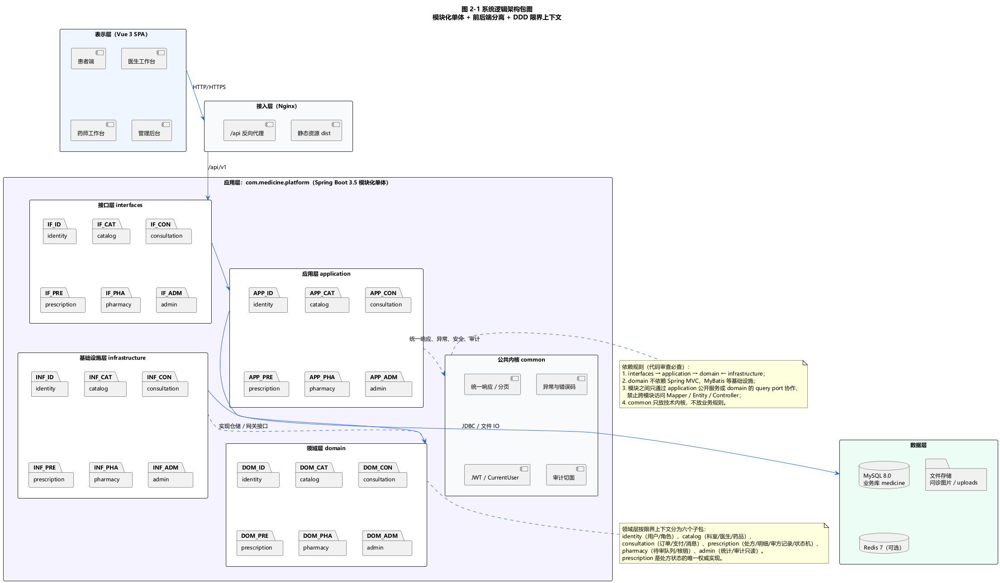

> 源文件：`docs/diagrams/design/architecture-package.puml`。图中只画「层与层」的依赖，避免模块内部箭头把图打乱；每个模块内部仍按 interfaces → application → domain ← infrastructure 组织。

**（1）分层职责与依赖规则**

| 层 | 职责 | 允许依赖 | 典型内容 |
|---|---|---|---|
| interfaces（接口层） | 接收 HTTP 请求、参数校验、组装 DTO、返回统一响应 | application | `*Controller`、请求/响应 DTO、Assembler |
| application（应用层） | 编排用例、开启事务、调用领域对象、发布事件 | domain、common | `*AppService`、`*Service`、事务边界 |
| domain（领域层） | 业务规则、状态机、实体/值对象、仓储接口 | common 的最小子集 | `Prescription`、`OrderStatus`、`PrescriptionStateMachine`、`*Repository` 接口 |
| infrastructure（基础设施层） | 实现仓储、访问 MySQL / 文件系统、外部网关 | domain、common | `*RepositoryImpl`、`*Mapper`、`*Gateway` |
| common（公共内核） | 统一响应、异常/错误码、JWT、当前用户、审计、配置 | 不依赖业务模块 | `ApiResponse`、`BizException`、`JwtTokenProvider`、`CurrentUser`、`AuditRecorder` |

依赖方向固定为：

```text
interfaces ──> application ──> domain
                    │              ▲
                    └──> common    │
infrastructure ────────────────────┘   （实现 domain 的仓储/网关接口）
```

必须能通过代码审查的四条规则：

1. `domain` 不依赖 `interfaces`、`infrastructure`，也不依赖 Spring MVC / MyBatis；
2. `application` 不直接写 SQL，只调用 `domain` 的仓储接口；
3. `infrastructure` 的 `RepositoryImpl` 实现 `domain` 的接口，由 Spring 注入；
4. `common` 不放业务规则，避免变成「万能工具包」。

**（2）限界上下文与模块职责**

| 模块 | 子域类型 | 负责什么 | 拥有的表 | 对应用例 | 对外暴露 |
|---|---|---|---|---|---|
| identity | 通用支撑域 | 注册、登录、JWT、角色、账号启停、当前用户 | `sys_user` | UC-01、UC-02（账号部分） | `AuthAppService`、`CurrentUser`、`UserQueryPort` |
| catalog | 通用支撑域 | 科室、医生目录、药品目录 | `department`、`doctor`、`drug` | UC-02（医生档案）、UC-03、UC-04 | `DoctorQueryPort`、`DrugQueryPort`、`DoctorQueryService` |
| consultation | 核心域 | 问诊订单、模拟支付、接诊/拒诊、图文消息、结束问诊 | `consultation_order`、`consultation_message` | UC-04～UC-08、UC-15 | `ConsultationOrderAppService`、`OrderQueryPort`、`MessageAppService` |
| prescription | 核心域 | 处方草稿、明细、提交、状态机、审方记录、核销、作废 | `prescription`、`prescription_item`、`prescription_review` | UC-09～UC-14、UC-16 | `PrescriptionAppService`、`PrescriptionQueryPort`、`PrescriptionStateMachine` |
| pharmacy | 支撑子域 | 药师待审队列、核销工作台；不重复实现处方规则 | 不单独建业务表（读处方模块） | UC-11～UC-14 | `ReviewQueueQueryService`（审方/核销入口调用 prescription 的 application 服务） |
| admin | 通用支撑域 | 账号管理入口、统计、审计日志查询 | `audit_log`（统计走只读查询） | UC-02、UC-17 | `StatsQueryService`、`AuditQueryService` |
| common | 技术内核 | 统一响应/异常/错误码、JWT、参数校验、审计切面 | 无业务表 | — | 被所有模块依赖 |

> 为什么把「审方 / 核销」放在 pharmacy，而状态机放在 prescription？
> 处方状态机是处方自己的不变量，必须和 `Prescription` 实体放在一起，不能散落在药师 Controller；pharmacy 只负责「药师工作台」的编排（待审队列、核销入口），具体迁移调用 `PrescriptionReviewAppService` / `DispenseAppService` 的用例方法。这样既体现药房是独立子域，又保证处方状态只有一个权威实现。

**（3）模块依赖规则**

| 调用方 | 被调用方 | 允许方式 | 说明 |
|---|---|---|---|
| consultation | identity | `UserQueryPort` | 校验患者/医生身份与状态 |
| consultation | catalog | `DoctorQueryPort` | 读取医生、科室与问诊价 |
| prescription | consultation | `OrderQueryPort`（只读） | 校验订单归属与「问诊中」状态 |
| prescription | catalog | `DrugQueryPort` | 校验药品启用、复制名称/单价快照 |
| prescription | identity | `UserQueryPort` | 校验医生/药师身份 |
| pharmacy | prescription | `PrescriptionReviewAppService` / `PrescriptionAppService` | 审方、核销的用例入口 |
| admin | identity、consultation、prescription | 只读 query port | 统计与审计查询，不写业务表 |
| 所有模块 | common | 直接依赖 | 统一响应、异常、安全、审计 |
| **禁止** | — | consultation → prescription | 结束问诊需要「已有处方」时，用处方流转事件更新订单标记，或由 consultation 定义端口倒置 |
| **禁止** | — | 跨模块直接依赖 infrastructure / Mapper / Entity | 必须通过 application 公开服务或 query port |

**（4）包结构**

```text
com.medicine.platform
├── common
│   ├── api          ApiResponse, PageResponse, ErrorCode
│   ├── exception    BizException, GlobalExceptionHandler
│   ├── security     SecurityConfig, JwtTokenProvider, JwtAuthenticationFilter,
│   │                CurrentUser, PermissionChecker
│   ├── audit        AuditRecorder, AuditEvent
│   └── config       JacksonConfig, WebMvcConfig, OpenApiConfig
├── identity
│   ├── interfaces   AuthController, AccountAdminController, dto
│   ├── application  AuthAppService, AccountAdminAppService
│   ├── domain       User, Role, UserStatus, UserRepository, UserQueryPort
│   └── infrastructure UserRepositoryImpl, UserMapper
├── catalog
│   ├── interfaces   DepartmentController, DoctorController, DrugController
│   ├── application  DoctorQueryService, DrugAppService
│   ├── domain       Department, Doctor, Drug, DoctorQueryPort, DrugQueryPort
│   └── infrastructure ...
├── consultation
│   ├── interfaces   ConsultationOrderController, MessageController
│   ├── application  ConsultationOrderAppService, MessageAppService, PasswordVerifier
│   ├── domain       ConsultationOrder, OrderStatus, ConsultationMessage,
│   │                ConsultationOrderRepository, MessageRepository
│   └── infrastructure ...
├── prescription
│   ├── interfaces   PrescriptionController
│   ├── application  PrescriptionDraftService, PrescriptionAppService,
│   │                PrescriptionReviewAppService, DispenseAppService,
│   │                PrescriptionQueryService
│   ├── domain       Prescription, PrescriptionItem, PrescriptionStatus,
│   │                PrescriptionStateMachine, ReviewRecord,
│   │                PrescriptionRepository, ReviewRecordRepository
│   └── infrastructure ...
├── pharmacy
│   ├── interfaces   PharmacyReviewController, PharmacyDispenseController
│   ├── application  ReviewQueueQueryService
│   ├── domain       ReviewQueueQuery
│   └── infrastructure ...
└── admin
    ├── interfaces   StatsController, AuditLogController
    ├── application  StatsQueryService, AuditQueryService
    ├── domain       StatsQueryPort, AuditQueryPort
    └── infrastructure ...
```

> 说明：S0 骨架只实现 `common`、`identity`、`catalog` 的部分内容，其余模块按 Sprint 增量填充；包结构从 S0 起就按上述结构建立，避免后期搬迁。

**（5）模块协作机制**

1. **同步调用**：上游模块通过 application 公开服务或 query port 提供能力，下游只依赖接口，不依赖实现；
2. **领域事件**：处方提交、审核通过、驳回、核销后分别发布 `PrescriptionSubmittedEvent`、`PrescriptionCirculatedEvent`、`PrescriptionRejectedEvent`、`PrescriptionDispensedEvent`；药师队列与问诊订单据此刷新，不互相查表；
3. **端口倒置**：`consultation` 需要判断「是否已有处方」而 `prescription` 又依赖 `consultation` 的订单查询时，由 `consultation` 定义 `PrescriptionGate` 接口、`prescription` 的 infrastructure 提供实现；本期优先用事件方式，代码更直观；
4. **事务边界**：一个用例一个本地事务；状态更新、审方记录、审计日志在同一事务内；领域事件在事务提交后发布。

#### 2.1.3 系统物理架构

**图 2-2 系统物理架构部署图**

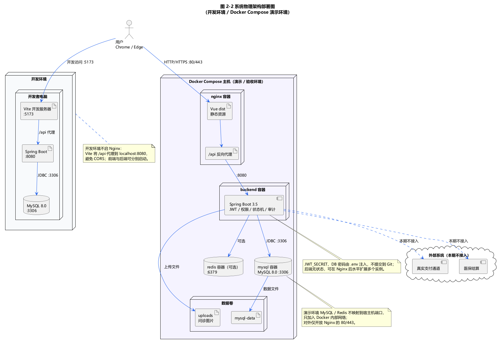

> 源文件：`docs/diagrams/design/architecture-deployment.puml`。

**（1）部署节点与端口**

| 节点 | 组件 | 端口 | 职责 |
|---|---|---|---|
| 用户浏览器 | Chrome / Edge | — | 访问 SPA；不直连数据库 |
| Web 服务器 | Nginx | 80/443 | 托管 Vue `dist`；`/api` 反向代理到后端；`/uploads` 静态文件 |
| 应用服务器 | Spring Boot 3.5（Docker） | 8080 | 认证、业务用例、权限、审计 |
| 数据库 | MySQL 8.0（Docker） | 3306 | 业务数据；仅容器网络可达 |
| 缓存（可选） | Redis 7（Docker） | 6379 | 后续令牌黑名单、医生目录缓存；本期不启用 |
| 文件卷 | Docker volume / 本地目录 | — | 问诊图片、上传文件；不存数据库 |

**（2）环境变量**

| 变量 | 示例 | 说明 |
|---|---|---|
| `SPRING_DATASOURCE_URL` | `jdbc:mysql://mysql:3306/medicine?useUnicode=true&characterEncoding=utf8&serverTimezone=Asia/Shanghai` | 容器内用服务名 `mysql` |
| `SPRING_DATASOURCE_USERNAME` | `medicine` | 不用 root 连接业务 |
| `SPRING_DATASOURCE_PASSWORD` | 由 `.env` 注入 | 不提交到 Git |
| `JWT_SECRET` | 至少 32 字节随机串 | 不提交到 Git；`.env.example` 只放占位符 |
| `JWT_EXPIRE_MINUTES` | `120` | 与需求 NFR-01 一致 |
| `UPLOAD_DIR` | `/app/uploads` | 挂载到 volume |
| `TZ` | `Asia/Shanghai` | 统一时区 |

**（3）开发环境与演示环境**

| 环境 | 前端 | 后端 | 数据库 | 启动方式 |
|---|---|---|---|---|
| 开发 | Vite `http://localhost:5173` | `http://localhost:8080` | `localhost:3306` | 分别 `npm run dev`、`mvn spring-boot:run` |
| 演示 | Nginx `http://localhost` | 容器内 `backend:8080` | 容器内 `mysql:3306` | `docker compose up -d` |

开发环境用 Vite 代理 `/api` 到 8080，避免 CORS；演示环境同源，不需要 CORS。若确实要跨域，只允许配置的前端 Origin，不使用 `*`。

**（4）安全边界与可扩展性**

- 演示环境 MySQL 端口不映射到宿主机，只加入 Docker 网络；对外仅开放 Nginx 的 80/443；
- 后端 8080 不直接对公网；`.env`、`application-prod.yml` 不提交；
- 上传目录禁止执行脚本，Nginx 对 `/uploads` 只读；
- 后端无状态（JWT），将来可在 Nginx 后挂多个实例；
- 文件存储可替换为 MinIO/OSS，不影响业务代码；
- 若问诊消息量增大，可把消息模块拆出并引入 WebSocket / MQ；本期不引入 Redis，避免多一个组件要装、要讲、要排错。


### 2.2 模块设计

#### 2.2.1 用例实现（设计模型）

本节的建模步骤：

1. 依据需求 2.3 的用例图与活动图，逐个用例识别**参与者**与**边界类**（页面、HTTP 入口）；
2. 在边界类之后识别**控制类**（用例编排的应用服务、领域服务、技术内核）；
3. 由控制类访问的领域对象识别**实体类**，并保留其关键属性与操作；
4. 用**鲁棒图**检查「参与者—边界—控制—实体」的协作是否完整、是否出现越层访问；
5. 用**顺序图**补充消息顺序、事务边界、异常返回与并发条件；
6. 汇总所有鲁棒图与顺序图，得到**表 2-1 设计类清单**与**图 2-3 设计类图**。

本期对 8 个主流程用例（UC-06、07、08、09、10、11、12、14）给出成对的鲁棒图与顺序图；其余用例在 2.2.1.9 以映射表说明，其类与主流程用例共用，不重复画图。

**表 2-1 设计类清单**

| 序号 | 对应用例 | 实体类 | 对应控制类 | 对应边界类 |
|---|---|---|---|---|
| 1 | UC-01 注册与登录 | User | AuthAppService | AuthController（登录/注册页） |
| 2 | UC-02 账号维护 | User、Doctor | AccountAdminAppService | AccountAdminController（管理后台账号页） |
| 3 | UC-03 药品目录维护 | Drug | DrugAppService | DrugController（药师药品页） |
| 4 | UC-04 浏览科室与医生 | Department、Doctor | DoctorQueryService | DoctorController（患者选医生页） |
| 5 | UC-05 提交问诊订单 | ConsultationOrder、Doctor、Department | ConsultationOrderAppService | ConsultationOrderController（患者下单页） |
| 6 | UC-06 支付问诊费 | ConsultationOrder、User | ConsultationOrderAppService、PasswordVerifier | ConsultationOrderController（支付页） |
| 7 | UC-07 接诊与拒诊 | ConsultationOrder | ConsultationOrderAppService、RefundGateway | ConsultationOrderController（医生待接诊页） |
| 8 | UC-08 图文问诊 | ConsultationMessage、ConsultationOrder | MessageAppService | MessageController（问诊会话面板） |
| 9 | UC-09 开具处方 | Prescription、PrescriptionItem、Drug | PrescriptionDraftService | PrescriptionController（处方编辑页） |
| 10 | UC-10 提交处方审核 | Prescription、PrescriptionItem、Drug | PrescriptionAppService、PrescriptionStateMachine | PrescriptionController（处方编辑页） |
| 11 | UC-11 审核处方通过 | Prescription、ReviewRecord | PrescriptionReviewAppService、PrescriptionStateMachine | PharmacyReviewController（药师审方页） |
| 12 | UC-12 驳回处方 | Prescription、ReviewRecord | PrescriptionReviewAppService、PrescriptionStateMachine | PharmacyReviewController（药师审方页） |
| 13 | UC-13 修改并重提处方 | Prescription、PrescriptionItem | PrescriptionDraftService、PrescriptionAppService | PrescriptionController（处方编辑页） |
| 14 | UC-14 核销处方 | Prescription | DispenseAppService、PrescriptionStateMachine | PharmacyDispenseController（药师核销页） |
| 15 | UC-15 结束问诊 | ConsultationOrder、Prescription（只读 query port） | ConsultationOrderAppService | ConsultationOrderController（医生订单详情页） |
| 16 | UC-16 查看处方与状态 | Prescription、PrescriptionItem、ReviewRecord | PrescriptionQueryService | PrescriptionController（处方详情页） |
| 17 | UC-17 统计与操作日志 | AuditLog（只读）、订单/处方读模型 | StatsQueryService、AuditQueryService | StatsController、AuditLogController（管理后台） |

> 说明：
> 1. 「边界类」同时包含前端页面与后端 Controller：页面负责与角色交互，Controller 负责 HTTP 入口、参数校验与 DTO 转换；
> 2. `PasswordVerifier`、`RefundGateway`、`PermissionChecker`、`AuditRecorder` 为技术内核控制类，不属于某个业务模块；
> 3. 一个用例出现多个控制类时，第一个为用例编排入口，第二个为协作者。

**图 2-3 设计类图（实体类与关系）**

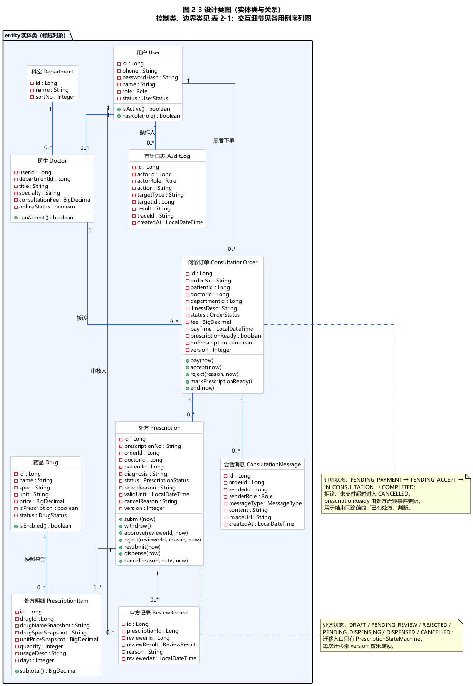

> 源文件：`docs/diagrams/design/design-class-diagram.puml`。图中只展开实体类及其关系；控制类与边界类见 表 2-1，交互顺序见各用例的顺序图。

**设计类职责摘要**

| 类别 | 类 | 职责 |
|---|---|---|
| 实体类 | User | 账号、密码摘要、角色、状态；判断能否登录 |
| 实体类 | Doctor / Department | 医生档案与科室归属；判断能否接诊 |
| 实体类 | ConsultationOrder | 问诊订单状态与支付信息；维护订单状态迁移 |
| 实体类 | ConsultationMessage | 会话消息内容、发送人、类型与时间 |
| 实体类 | Prescription | 处方状态与有效期；维护 9 条状态迁移 |
| 实体类 | PrescriptionItem | 药品快照、数量、用法用量、天数与小计 |
| 实体类 | Drug | 药品目录、单价、启用状态；控制能否开方 |
| 实体类 | ReviewRecord | 审方结果、理由、审核人与时间；不可修改 |
| 实体类 | AuditLog | 关键操作留痕：谁、何时、对什么、结果 |
| 控制类 | *AppService / *Service | 用例编排、事务边界、权限与归属校验 |
| 控制类 | PrescriptionStateMachine | 迁移白名单与合法性校验，唯一状态入口 |
| 控制类 | PasswordVerifier / RefundGateway | 模拟支付密码校验 / 模拟退款 |
| 控制类 | PermissionChecker / AuditRecorder | 统一权限判定 / 统一审计写入 |
| 边界类 | *Controller | HTTP 入口、参数校验、DTO 组装、统一响应 |
| 边界类 | 前端页面 | 表单、列表、状态时间线、二次确认 |

##### 2.2.1.1 UC-06 支付问诊费

**前置条件**：患者已登录；订单存在、属于当前患者且状态为「待支付」。

**主成功场景**：患者在支付页输入登录密码 → 提交支付 → 系统校验归属、状态与密码 → 订单转「待接诊」并记录支付时间 → 返回支付成功。

**异常分支**：订单不存在/不属于当前患者 → 404；状态不是待支付 → 409；密码错误 → 400，订单保持待支付可重试；并发更新失败 → 409。

**设计要点**：
1. 密码只用于当次校验，不落库、不回显；BCrypt 比对在 `PasswordVerifier` 内完成；
2. 状态更新带 `status='PENDING_PAYMENT' AND version=?` 条件，受影响行数为 0 返回 409；
3. 支付成功写审计日志；待支付超过 30 分钟由定时任务关闭订单（对应需求 A.5）。

**图 2-4 UC-06 支付问诊费 · 鲁棒图**

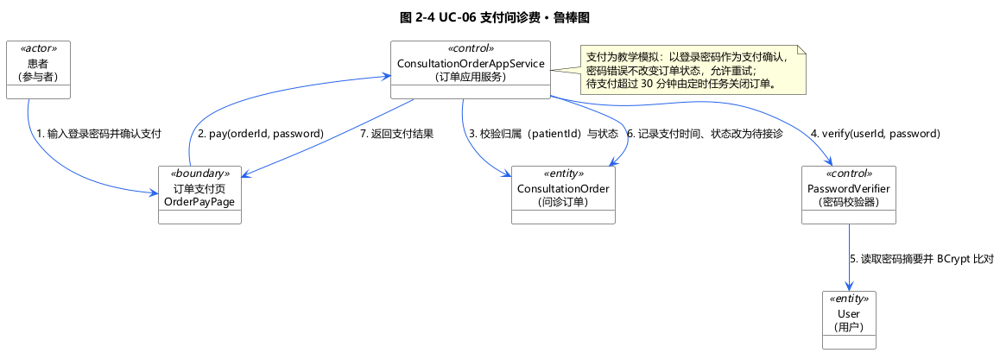

**图 2-5 UC-06 支付问诊费 · 顺序图**

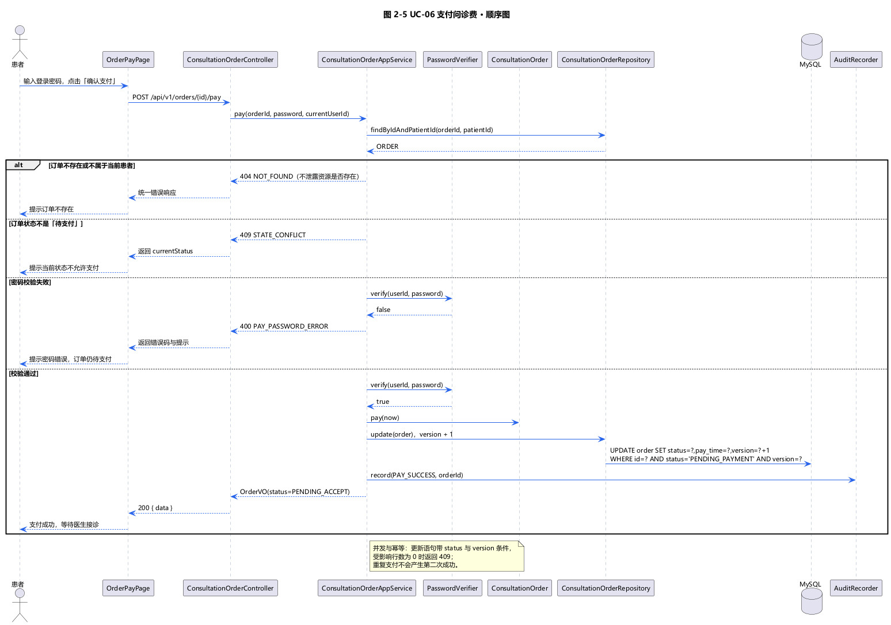

##### 2.2.1.2 UC-07 接诊与拒诊

**前置条件**：医生已登录；订单已支付、状态为「待接诊」且属于该医生。

**主成功场景**：医生在待接诊列表选择订单 → 接诊 → 订单转「问诊中」并记录接诊时间；或拒诊 → 填写理由 → 订单取消、模拟退款、写审计。

**异常分支**：订单不存在/不属于当前医生 → 404；状态不是待接诊 → 409；拒诊理由为空 → 400；并发处理 → 409。

**设计要点**：
1. 接诊与拒诊都必须在查询条件中带 `doctor_id`，不能先查后判；
2. 拒诊是订单终态之一，退款为教学模拟（`RefundGateway` 只返回结果并写审计）；
3. 状态更新使用乐观锁，保证两人同时操作时只有一次成功。

**图 2-6 UC-07 接诊与拒诊 · 鲁棒图**

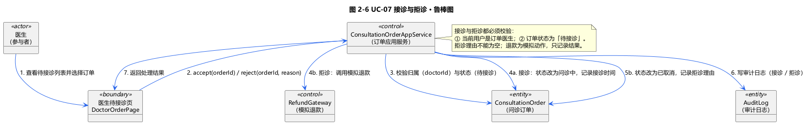

**图 2-7 UC-07 接诊与拒诊 · 顺序图**

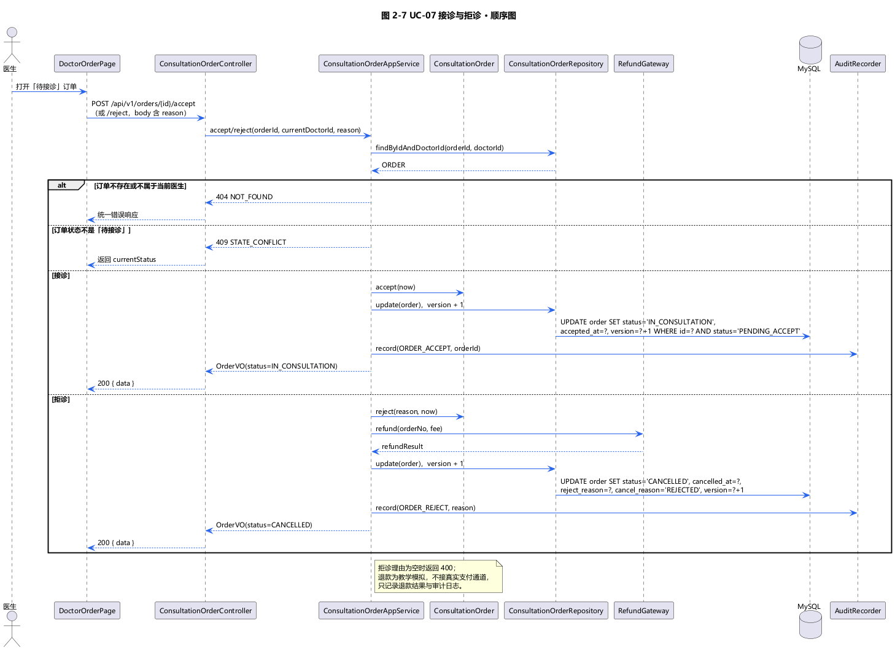

##### 2.2.1.3 UC-08 图文问诊

**前置条件**：订单处于「问诊中」；当前用户是订单患者或接诊医生。

**主成功场景**：参与人输入文字或选择图片 → 发送 → 服务校验参与人与订单状态 → 保存消息 → 对方轮询在 3 秒内看到新消息。

**异常分支**：非订单参与人 → 404；订单已完成/已取消 → 409（会话只读）；内容为空或超过 1000 字 → 400。

**设计要点**：
1. 消息读写都带订单参与人校验，患者的消息只有本人与接诊医生可见；
2. 图片先上传得到 URL，再以 `message_type=IMAGE` 保存，消息表不存二进制；
3. 本期用轮询（3 秒）而非 WebSocket，满足演示要求并减少一个技术组件。

**图 2-8 UC-08 图文问诊 · 鲁棒图**

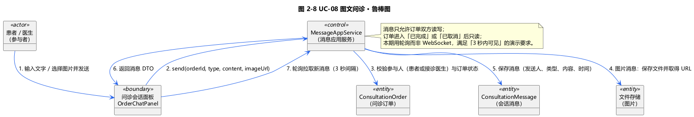

**图 2-9 UC-08 图文问诊 · 顺序图**

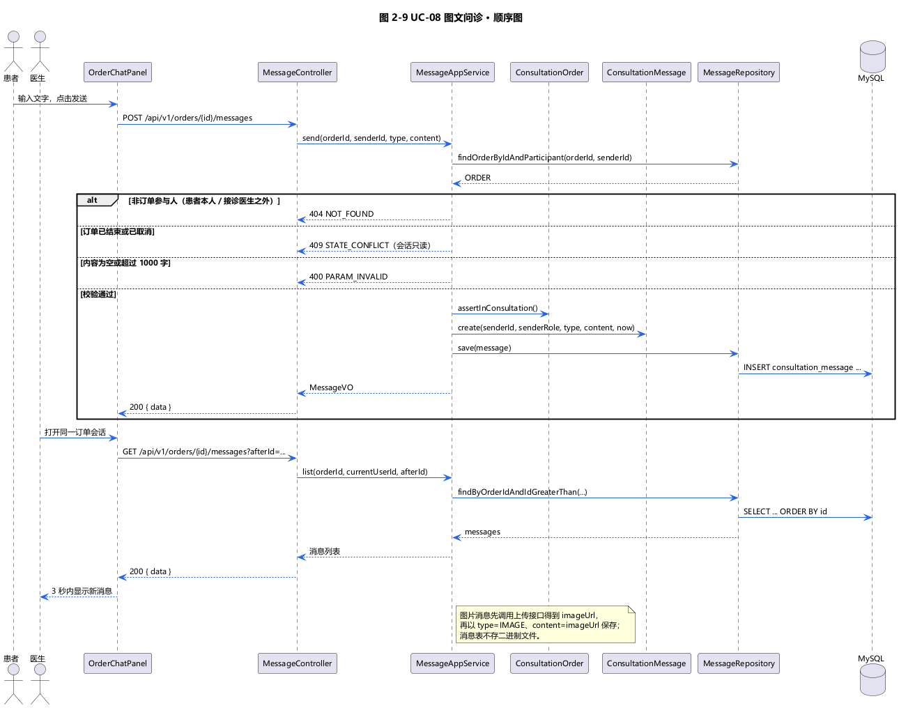

##### 2.2.1.4 UC-09 开具处方（草稿）

**前置条件**：医生已接诊该订单，订单处于「问诊中」。

**主成功场景**：医生进入处方编辑页 → 系统创建/读取草稿 → 检索并选择药品、填写诊断与用法用量 → 保存草稿 → 返回处方详情。

**异常分支**：订单不属于当前医生/不在问诊中 → 404/409；诊断为空、明细为空或超过 5 条 → 400；药品已停用 → 400。

**设计要点**：
1. 草稿状态为 `DRAFT`，可反复编辑，不影响订单状态；
2. 明细保存 `drugNameSnapshot`、`drugSpecSnapshot`、`unitPriceSnapshot` 三个快照，后续药品调价不影响历史处方；
3. 明细数量限制 1～5 条（需求 A.3 T1 前置条件），保存时校验。

**图 2-10 UC-09 开具处方（草稿） · 鲁棒图**

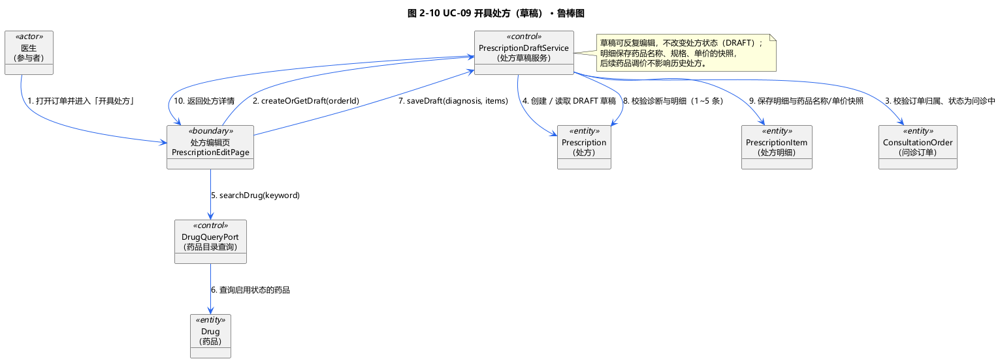

**图 2-11 UC-09 开具处方（草稿） · 顺序图**

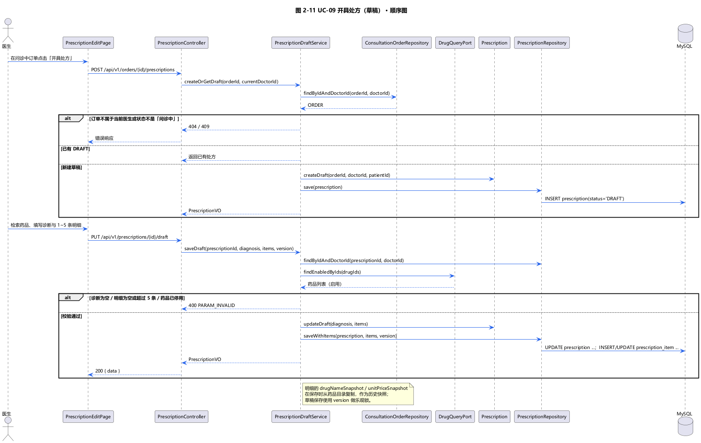

##### 2.2.1.5 UC-10 提交处方审核

**前置条件**：处方属于当前医生，状态为 `DRAFT` 或 `REJECTED`，诊断与明细满足提交校验。

**主成功场景**：医生点击提交 → 状态机校验 → 诊断非空、明细 1～5 条、药品均启用 → 状态转「待审核」并写提交时间 → 写审计、发布事件 → 药师队列刷新。

**异常分支**：处方不存在/不属于当前医生 → 404；状态不允许提交 → 409；参数非法 → 400；药品停用 → 400；版本冲突 → 409。

**设计要点**：
1. 状态合法性由 `PrescriptionStateMachine.assertCanSubmit()` 统一判断，Controller 不写 `if (status == ...)`；
2. 更新语句同时带状态与版本条件，避免「撤回与提交同时发生」；
3. 提交成功后发布 `PrescriptionSubmittedEvent`，药师队列通过事件刷新，不直接查处方表。

**图 2-12 UC-10 提交处方审核 · 鲁棒图**

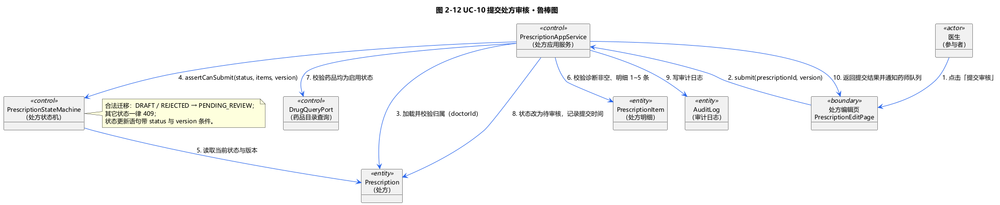

**图 2-13 UC-10 提交处方审核 · 顺序图**

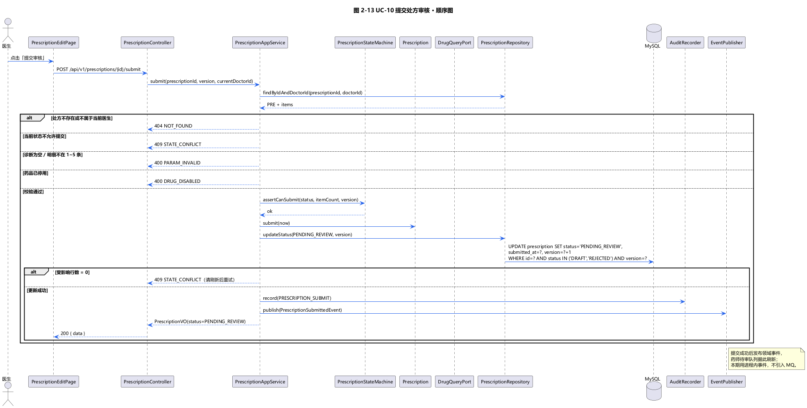

##### 2.2.1.6 UC-11 审核处方通过

**前置条件**：药师已登录；处方状态为「待审核」。

**主成功场景**：药师在待审队列选择处方 → 通过 → 系统校验状态与版本 → 状态转「待核销」、设置 3 天有效期 → 写审方记录与审计 → 发布事件。

**异常分支**：处方不存在 → 404；状态不是待审核或版本冲突 → 409。

**设计要点**：
1. 审核通过即对患者产生取药承诺，不能回退；需要撤销只能走「作废」并留痕；
2. 有效期从审核通过时刻起算 3 天，到期由定时任务置为「已作废」（T9）；
3. 审方记录与状态更新在同一事务内，保证「有状态必有记录」。

**图 2-14 UC-11 审核处方通过 · 鲁棒图**

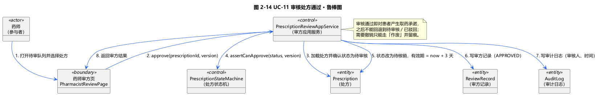

**图 2-15 UC-11 审核处方通过 · 顺序图**

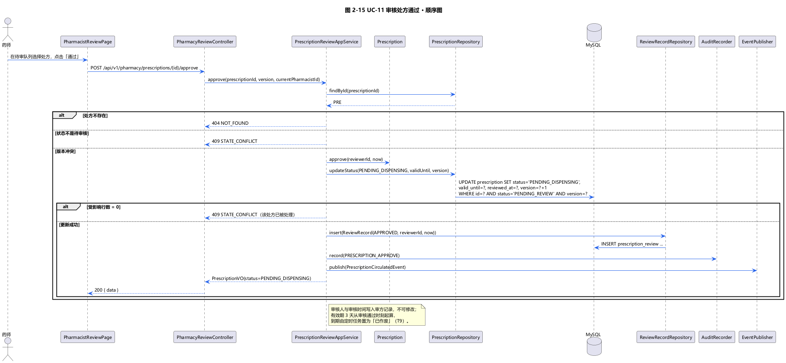

##### 2.2.1.7 UC-12 驳回处方

**前置条件**：药师已登录；处方状态为「待审核」。

**主成功场景**：药师填写驳回理由 → 驳回 → 系统校验理由长度与状态 → 状态转「已驳回」、记录理由 → 写审方记录（REJECTED）与审计 → 发布事件，医生端可见理由。

**异常分支**：处方不存在 → 404；理由少于 10 字 → 400；状态不是待审核或版本冲突 → 409。

**设计要点**：
1. 驳回是独立状态 `REJECTED`，不退回 `DRAFT`：必须能查到「哪一版被谁以什么理由驳回」；
2. 审方记录保留完整历史，医生修改重提后仍可追溯上一次驳回；
3. 医生端通过处方状态与事件感知驳回，本期不单独建通知表。

**图 2-16 UC-12 驳回处方 · 鲁棒图**

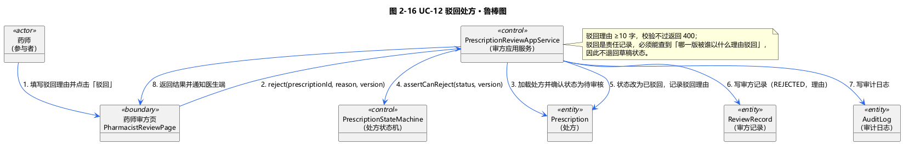

**图 2-17 UC-12 驳回处方 · 顺序图**

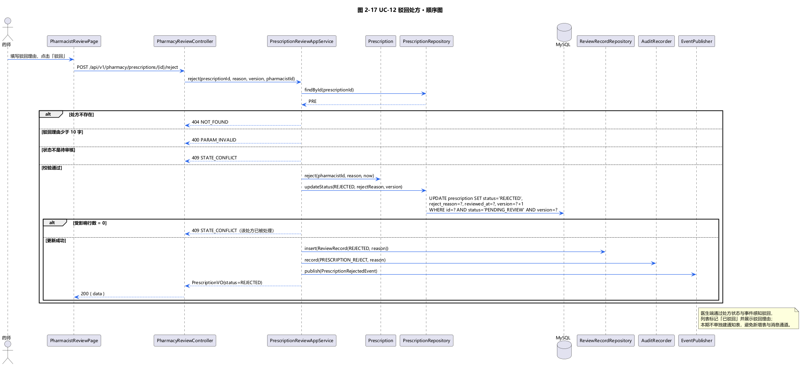

##### 2.2.1.8 UC-14 核销处方

**前置条件**：药师已登录；处方状态为「待核销」且未超过有效期。

**主成功场景**：药师输入处方号 → 核销 → 系统校验状态与有效期 → 状态转「已核销」、记录核销时间 → 写审计 → 发布事件，订单可结束问诊。

**异常分支**：处方不存在 → 404；状态不是待核销（已核销/已作废） → 409；已过期 → 409；版本冲突 → 409。

**设计要点**：
1. 核销语句同时带 `status='PENDING_DISPENSING'`、`valid_until >= NOW()` 与 `version` 条件，重复核销自然失败；
2. 过期处方由定时任务置为 `CANCELLED`（`cancel_reason='EXPIRED'`），核销时也会拒绝；
3. 核销成功后发布 `PrescriptionDispensedEvent`，`consultation` 更新订单的「已有处方」标记，不直接查处方表。

**图 2-18 UC-14 核销处方 · 鲁棒图**

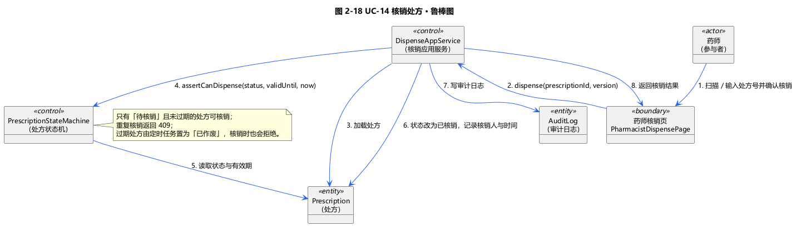

**图 2-19 UC-14 核销处方 · 顺序图**

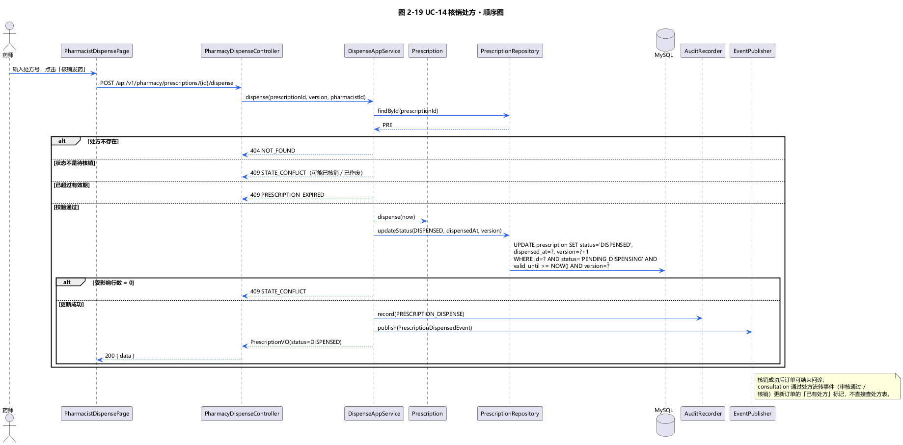

##### 2.2.1.9 其余用例的实现映射

以下用例的边界类、控制类、实体类已列入 表 2-1，交互由主流程用例的序列图覆盖，不再单独画图：

| 用例 | 实现说明 |
|---|---|
| UC-01 注册与登录 | `AuthAppService` 校验手机号唯一、BCrypt 密码、账号 `ACTIVE`；签发 JWT（2 小时），角色写入 token；`AuthController` 返回用户信息与角色菜单。 |
| UC-02 账号维护 | `AccountAdminAppService` 创建医生/药师账号、分配科室、重置密码、启停账号；停用账号登录直接 403/401，历史数据保留。 |
| UC-03 药品目录维护 | `DrugAppService` 新增/修改/停用药品；停用后不可开入新处方，已开处方使用明细快照，不受影响。 |
| UC-04 浏览科室与医生 | `DoctorQueryService` 按科室筛选医生，返回职称、擅长、问诊价、在线状态；只读，不涉及写事务。 |
| UC-05 提交问诊订单 | `ConsultationOrderAppService` 校验患者、医生、病情描述 10～500 字，生成「待支付」订单与订单号；30 分钟未支付由定时任务关闭。 |
| UC-13 修改并重提处方 | 医生在「已驳回」处方上修改诊断/明细，复用 UC-09 的草稿保存与 UC-10 的提交逻辑；处方号不变，状态按 T5 回到「待审核」，审方记录追加一条。 |
| UC-15 结束问诊 | 医生点击结束；`ConsultationOrderAppService` 校验订单状态为「问诊中」，且满足「已有待核销/已核销处方」或「勾选无需处方」；订单转「已完成」。处方是否存在通过事件维护的订单标记判断，不直接依赖处方模块。 |
| UC-16 查看处方与状态 | `PrescriptionQueryService` 按角色与归属过滤；返回处方详情、明细、状态时间线与审方记录；患者只能看自己的处方，药师可看待审/待核销，管理员只读全部。 |
| UC-17 统计与操作日志 | `StatsQueryService` 聚合订单量、处方量、驳回率与核销率（只读查询）；`AuditQueryService` 按时间、操作人、动作查询审计日志；不修改业务数据。 |

#### 2.2.2 关键程序逻辑设计

本节选取 4 个最关键、分支最多的程序逻辑，用活动图描述关键类的关键操作。活动图与需求附录 A 的状态图配合阅读：状态图回答「有哪些状态与迁移」，活动图回答「一次请求内部怎么校验、更新、写日志、发事件」。

##### 2.2.2.1 支付问诊费（UC-06）

**关键类与操作**：`ConsultationOrderAppService.pay(orderId, password, patientId)`、`PasswordVerifier.verify(userId, password)`、`ConsultationOrder.pay(now)`。

**关键逻辑**：
1. 以 `id + patient_id` 加载订单（归属校验前置到查询条件）；
2. 校验状态为 `PENDING_PAYMENT`；
3. BCrypt 比对登录密码，失败返回 400，订单状态不变；
4. 更新语句带 `status` 与 `version` 条件，失败返回 409；
5. 写审计日志，返回订单新状态。

**图 2-20 活动图：问诊订单支付（UC-06）**

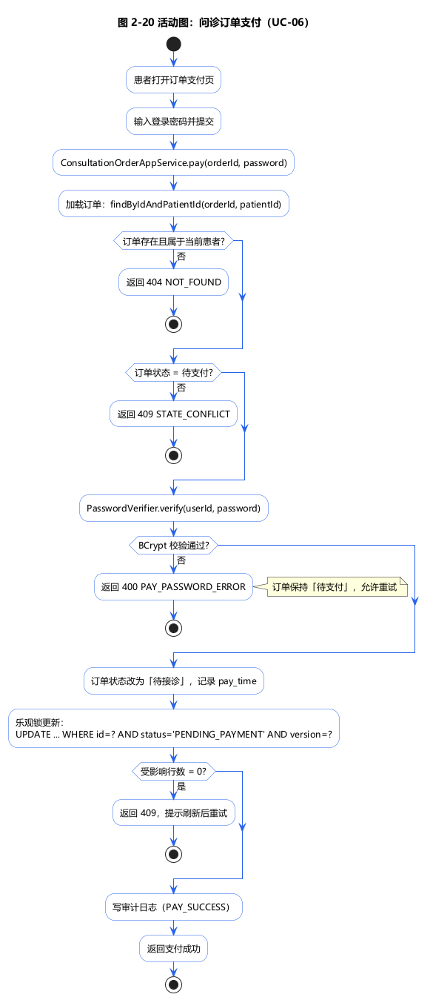

##### 2.2.2.2 提交处方审核（UC-10）

**关键类与操作**：`PrescriptionAppService.submit(id, version, doctorId)`、`PrescriptionStateMachine.assertCanSubmit(...)`、`DrugQueryPort.findEnabledByIds(...)`、`Prescription.submit(now)`。

**关键逻辑**：
1. 以 `id + doctor_id` 加载处方，校验归属；
2. 状态机判断 `DRAFT` / `REJECTED` 才允许提交；
3. 校验诊断非空、明细 1～5 条、药品均启用；
4. 更新语句带状态与 `version` 条件，失败返回 409；
5. 同一事务写审计；事务提交后发布 `PrescriptionSubmittedEvent`。

**图 2-21 活动图：提交处方审核（UC-10）**

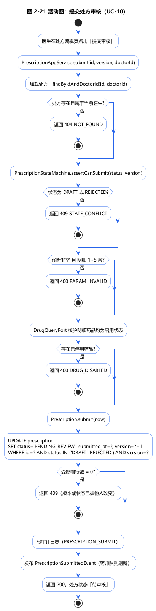

##### 2.2.2.3 审方、驳回与修改重提（UC-11 / UC-12 / UC-13）

**关键类与操作**：`PrescriptionReviewAppService.approve(...)`、`PrescriptionReviewAppService.reject(...)`、`PrescriptionStateMachine`、`Prescription.approve/reject/resubmit`。

**关键逻辑**：
1. 加载处方并校验状态为 `PENDING_REVIEW`；
2. 通过：计算 `validUntil = now + 3 天`，状态转 `PENDING_DISPENSING`，写审方记录（APPROVED）；
3. 驳回：理由 ≥10 字，状态转 `REJECTED`，写审方记录（REJECTED），医生端可见理由；
4. 修改重提：医生修改草稿内容后重新提交，状态按 T5 回到 `PENDING_REVIEW`，处方号不变；
5. 所有更新带 `version` 条件；审方记录与状态更新在同一事务。

**图 2-22 活动图：审方、驳回与修改重提（UC-11 / UC-12 / UC-13）**

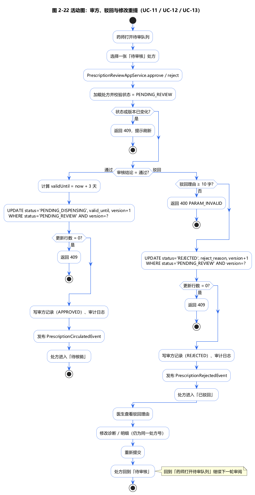

##### 2.2.2.4 核销发药与过期作废（UC-14）

**关键类与操作**：`DispenseAppService.dispense(id, version, pharmacistId)`、`PrescriptionStateMachine.assertCanDispense(...)`、`Prescription.dispense(now)`、`PrescriptionExpiryJob`。

**关键逻辑**：
1. 校验状态为 `PENDING_DISPENSING`、`now <= validUntil`；
2. 更新语句带状态、有效期与版本条件，重复核销/过期核销自然失败；
3. 写审计、发布 `PrescriptionDispensedEvent`；
4. 定时任务扫描过期处方，置为 `CANCELLED`，`cancel_reason='EXPIRED'`（T9）；
5. 核销与过期任务可能并发，都以 `status='PENDING_DISPENSING'` 为条件，只有一方成功。

**图 2-23 活动图：核销发药与过期作废（UC-14）**

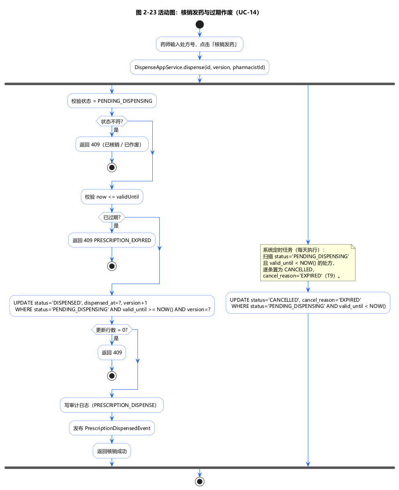

##### 2.2.2.5 处方状态机的实现约定

需求附录 A 给出 6 个状态、9 条迁移。实现时把迁移表编码为**白名单**，所有入口统一调用 `PrescriptionStateMachine`，不在 Controller/Service 里散写状态判断。

**处方状态迁移白名单与实现方式**

| 迁移 | 源 → 目标 | 动作 / 方法 | 更新条件（WHERE） | 同一事务内的副作用 |
|---|---|---|---|---|
| T1 | DRAFT → PENDING_REVIEW | 提交 `submit()` | `status='DRAFT' AND version=?` | 写提交时间、审计；发布 Submitted 事件 |
| T2 | PENDING_REVIEW → DRAFT | 撤回 `withdraw()` | `status='PENDING_REVIEW' AND version=?` | 清空提交时间；审计 |
| T3 | PENDING_REVIEW → PENDING_DISPENSING | 通过 `approve()` | `status='PENDING_REVIEW' AND version=?` | 设置 `valid_until=now+3d`；写 ReviewRecord(APPROVED)、审计；发布 Circulated 事件 |
| T4 | PENDING_REVIEW → REJECTED | 驳回 `reject()` | `status='PENDING_REVIEW' AND version=?` | 写 `reject_reason`；写 ReviewRecord(REJECTED)、审计；发布 Rejected 事件 |
| T5 | REJECTED → PENDING_REVIEW | 修改重提 `resubmit()` | `status='REJECTED' AND version=?` | 写提交时间；追加审方记录；发布 Submitted 事件 |
| T6 | REJECTED → CANCELLED | 废弃 `cancel('REJECTED_ABANDON')` | `status='REJECTED' AND version=?` | 写 `cancel_reason`、`cancel_note`、审计 |
| T7 | DRAFT → CANCELLED | 作废草稿 `cancel('DRAFT_DISCARD')` | `status='DRAFT' AND version=?` | 写 `cancel_reason`、`cancel_note`、审计 |
| T8 | PENDING_DISPENSING → DISPENSED | 核销 `dispense()` | `status='PENDING_DISPENSING' AND valid_until>=NOW() AND version=?` | 写核销时间、审计；发布 Dispensed 事件 |
| T9 | PENDING_DISPENSING → CANCELLED | 过期作废（系统） | `status='PENDING_DISPENSING' AND valid_until<NOW()` | 写 `cancel_reason='EXPIRED'`、系统审计 |

**并发与异常约定**：
1. 所有**人工触发**的状态更新使用 `UPDATE ... WHERE id=? AND status=? AND version=?`，`version = version + 1`；
2. 影响行数为 0 一律返回 409，并返回当前状态与版本，前端提示「该处方已被处理，请刷新」；
3. 状态更新、审方记录、审计日志在同一本地事务；领域事件在事务提交后发布；
4. 定时任务（订单 30 分钟超时、处方过期）同样通过状态机/实体方法执行，不在 Job 中散写状态判断；
5. 不在白名单中的迁移一律按非法操作处理，返回 409。


## 3 数据库设计

### 3.1 数据库表设计

#### 3.1.1 类模型到关系模型的映射策略

数据库设计以需求 2.4 的领域模型和 2.2.1 的设计类为基础，映射规则如下：

1. **实体类 1:1 映射为表**：`User→sys_user`、`Doctor→doctor`、`Department→department`、`ConsultationOrder→consultation_order`、`ConsultationMessage→consultation_message`、`Drug→drug`、`Prescription→prescription`、`PrescriptionItem→prescription_item`、`ReviewRecord→prescription_review`、`AuditLog→audit_log`。
2. **继承用共享主键**：`Doctor` 是 `User` 的 1:1 扩展，`doctor.user_id` 既是主键又是逻辑外键，指向 `sys_user.id`；不采用单表继承，避免用户表出现大量医生专属空字段。
3. **主从关系用外键 + 应用层级联**：`Prescription 1:N PrescriptionItem`、`Prescription 1:N ReviewRecord`、`ConsultationOrder 1:N Prescription`；从表由主表聚合根统一保存，删除动作由应用层控制，不依赖数据库级联。
4. **枚举用 VARCHAR 存编码**：`role`、`status`、`message_type`、`review_result` 等保存 `DRAFT`、`PENDING_REVIEW` 这类可读编码，由应用层 Enum 映射；不用 TINYINT，便于排错与数据核对。
5. **快照字段**：处方明细保存 `drug_name_snapshot`、`drug_spec_snapshot`、`unit_price_snapshot`，保证药品调价/停用后历史处方仍可还原。
6. **金额与时间**：金额统一 `DECIMAL(10,2)`，单位元；时间统一 `DATETIME(3)`，连接参数 `serverTimezone=Asia/Shanghai`，页面按东八区展示。
7. **乐观锁**：`consultation_order`、`prescription` 增加 `version INT NOT NULL DEFAULT 0`，每次状态迁移加 1。
8. **审计字段**：业务表统一 `created_at` / `updated_at`；关键业务动作另写 `audit_log`，与业务表分开，避免审计查询拖慢业务查询。
9. **逻辑外键**：设计文档与 ER 图中标注外键关系，DDL 不建物理外键。理由：① 表按 Sprint 增量创建，物理外键会限制建表顺序；② 演示数据需要反复清空/重建；③ 课程项目由应用层 + 索引保证一致性即可。生产环境如需强约束可再补物理外键。
10. **字符集与引擎**：`InnoDB`、`utf8mb4`、`utf8mb4_unicode_ci`；主键 `BIGINT` 自增；索引命名 `PK_`（主键）、`uk_表_字段`（唯一）、`idx_表_字段`（普通）。

#### 3.1.2 数据库表名清单

**表 2-2 数据库表名清单**

| 序号 | 中文表名 | 英文表名 | 表功能说明 | 所属模块 | 建表 Sprint |
|---|---|---|---|---|---|
| 1 | 用户表 | `sys_user` | 账号、密码摘要、姓名、角色、状态；四类角色统一存储 | identity | S0 |
| 2 | 科室表 | `department` | 科室字典与排序，医生归属科室 | catalog | S1 |
| 3 | 医生表 | `doctor` | 医生档案：职称、擅长、问诊价、在线状态；与用户 1:1 | catalog | S1 |
| 4 | 问诊订单表 | `consultation_order` | 问诊订单：病情描述、状态、问诊费、支付/接诊/取消信息 | consultation | S1 |
| 5 | 会话消息表 | `consultation_message` | 订单内文字/图片消息 | consultation | S2 |
| 6 | 药品表 | `drug` | 药品目录：名称、规格、单价、处方药标记、启用状态 | catalog | S2 |
| 7 | 处方表 | `prescription` | 处方主表：诊断、状态、驳回理由、有效期、作废原因 | prescription | S2 |
| 8 | 处方明细表 | `prescription_item` | 处方药品明细、药品快照、数量、用法用量、小计 | prescription | S2 |
| 9 | 审方记录表 | `prescription_review` | 每次审核的结果、理由、审核人、时间 | prescription | S3 |
| 10 | 审计日志表 | `audit_log` | 关键操作留痕：操作人、动作、对象、结果、traceId | admin（写入由 common 审计切面完成） | S4 |

> 表数量与需求 1.2「S1 建 3 张、S2 建 4 张、S3 建 1 张、S4 建 1 张」一致（S0 另建 `sys_user`）。

#### 3.1.3 表间关系

**图 2-24 数据库 ER 图（10 张表）**

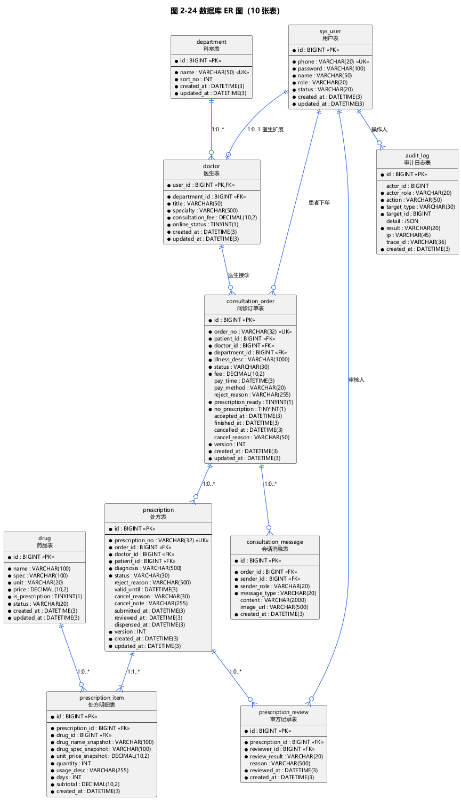

> 源文件：`docs/diagrams/design/database-er.puml`。图中 `*` 表示非空字段，`<<PK>>` / `<<UK>>` / `<<FK>>` 分别表示主键、唯一键与逻辑外键。

主要关系说明：

1. `sys_user 1:0..1 doctor`：只有医生角色的用户才有医生档案；
2. `department 1:0..* doctor`：一个科室多名医生；
3. `sys_user 1:0..* consultation_order`：患者下单；`doctor 1:0..* consultation_order`：医生接诊；
4. `consultation_order 1:0..* consultation_message`：一个订单多条消息；
5. `consultation_order 1:0..* prescription`：一次问诊可产生多张处方（含作废后重开）；
6. `prescription 1:1..* prescription_item`：处方至少一条明细；
7. `prescription 1:0..* prescription_review`：驳回后重提会产生多条审方记录；
8. `prescription_item 0..*:1 drug`：明细引用药品，但展示以快照字段为准；
9. `sys_user 1:0..* audit_log`：操作用户写审计；系统任务 `actor_id` 为空、`actor_role='SYSTEM'`。

#### 3.1.4 索引与查询场景

| 查询场景 | 使用的索引 | 说明 |
|---|---|---|
| 登录（按手机号） | `uk_sys_user_phone` | 唯一索引，等值查询 |
| 患者查看自己的订单 | `idx_order_patient_status` | 患者 + 状态 + 时间排序 |
| 医生查看待接诊/问诊中订单 | `idx_order_doctor_status` | 医生 + 状态 + 时间排序 |
| 订单超时关闭任务 | `idx_order_status_created` | 按状态与创建时间扫描 |
| 会话消息增量拉取 | `idx_message_order` | 订单 + 消息 id 递增 |
| 药师待审队列 | `idx_prescription_status` + `idx_prescription_order` | 状态 + 创建时间排序 |
| 患者查看处方列表 | `idx_prescription_patient` | 患者 + 创建时间 |
| 医生查看处方列表 | `idx_prescription_doctor` | 医生 + 创建时间 |
| 过期处方扫描 | `idx_prescription_valid_until` | 状态 + 有效期 |
| 审方记录查询 | `idx_review_prescription` | 处方 + 审核时间 |
| 审计日志检索 | `idx_audit_target` / `idx_audit_actor` / `idx_audit_action` | 按对象、操作人、动作 |

### 3.2 数据库表的详细清单

> 字段说明：`空否` 中「否」表示 `NOT NULL`；`默认值` 中 `-` 表示无默认值；`主键/外键` 中 `PK` 为主键、`FK→表.字段` 为逻辑外键；`索引否` 标注该字段是否单独建索引，完整索引见每张表下方的索引清单。
> 命名约定：主键统一 `id`；时间字段统一 `_at` 后缀；快照字段统一 `_snapshot` 后缀；状态字段统一 `status`。

#### 3.2.1 表 2-3-1 用户表：sys_user

| 序号 | 字段中文名 | 字段英文名 | 类型、宽度、精度 | 取值约束 | 空否 | 默认值 | 主键/外键 | 索引否 |
|---|---|---|---|---|---|---|---|---|
| 1 | 主键 | id | BIGINT | 自增、>0 | 否 | - | PK | 是（主键） |
| 2 | 手机号 | phone | VARCHAR(20) | 11 位数字、全局唯一 | 否 | - | - | 是（唯一） |
| 3 | 密码摘要 | password | VARCHAR(100) | BCrypt 摘要，60 字符 | 否 | - | - | 否 |
| 4 | 姓名 | name | VARCHAR(50) | 1～50 字 | 否 | - | - | 否 |
| 5 | 角色 | role | VARCHAR(20) | PATIENT / DOCTOR / PHARMACIST / ADMIN | 否 | - | - | 是 |
| 6 | 状态 | status | VARCHAR(20) | ACTIVE / DISABLED | 否 | 'ACTIVE' | - | 否 |
| 7 | 创建时间 | created_at | DATETIME(3) | 服务器写入 | 否 | CURRENT_TIMESTAMP(3) | - | 否 |
| 8 | 更新时间 | updated_at | DATETIME(3) | 自动更新 | 否 | CURRENT_TIMESTAMP(3) | - | 否 |

**sys_user 索引清单**

| 索引名 | 索引特性 | 索引字段 | 说明 |
|---|---|---|---|
| `PRIMARY` | 主键索引 | `id` | 聚簇索引 |
| `uk_sys_user_phone` | 唯一索引 unique | `phone` | 登录账号唯一 |
| `idx_sys_user_role` | 普通索引 | `role` | 按角色统计/筛选 |

> 本表在 S0 已由 `src/main/resources/db/init.sql` 建立，字段与之一致；后续 Sprint 不修改结构，只增量插入医生/药师账号。种子数据密码均为 `123456` 的 BCrypt 摘要。

#### 3.2.2 表 2-3-2 科室表：department

| 序号 | 字段中文名 | 字段英文名 | 类型、宽度、精度 | 取值约束 | 空否 | 默认值 | 主键/外键 | 索引否 |
|---|---|---|---|---|---|---|---|---|
| 1 | 主键 | id | BIGINT | 自增、>0 | 否 | - | PK | 是（主键） |
| 2 | 科室名 | name | VARCHAR(50) | 1～50 字、全局唯一 | 否 | - | - | 是（唯一） |
| 3 | 排序号 | sort_no | INT | ≥0，越小越靠前 | 否 | 0 | - | 是 |
| 4 | 创建时间 | created_at | DATETIME(3) | 服务器写入 | 否 | CURRENT_TIMESTAMP(3) | - | 否 |
| 5 | 更新时间 | updated_at | DATETIME(3) | 自动更新 | 否 | CURRENT_TIMESTAMP(3) | - | 否 |

**department 索引清单**

| 索引名 | 索引特性 | 索引字段 | 说明 |
|---|---|---|---|
| `PRIMARY` | 主键索引 | `id` | 聚簇索引 |
| `uk_department_name` | 唯一索引 unique | `name` | 科室名唯一 |
| `idx_department_sort` | 普通索引 | `sort_no` | 科室列表排序 |

#### 3.2.3 表 2-3-3 医生表：doctor

| 序号 | 字段中文名 | 字段英文名 | 类型、宽度、精度 | 取值约束 | 空否 | 默认值 | 主键/外键 | 索引否 |
|---|---|---|---|---|---|---|---|---|
| 1 | 医生用户 ID | user_id | BIGINT | 取自 `sys_user.id`，与用户 1:1 | 否 | - | PK、FK→sys_user.id | 是（主键） |
| 2 | 科室 ID | department_id | BIGINT | 引用已存在科室 | 否 | - | FK→department.id | 是 |
| 3 | 职称 | title | VARCHAR(50) | 主任医师/副主任医师/主治医师等 | 否 | '' | - | 否 |
| 4 | 擅长 | specialty | VARCHAR(500) | ≤500 字 | 否 | '' | - | 否 |
| 5 | 问诊价 | consultation_fee | DECIMAL(10,2) | ≥0.00，单位元 | 否 | 0.00 | - | 否 |
| 6 | 在线状态 | online_status | TINYINT(1) | 0=离线，1=在线 | 否 | 0 | - | 是 |
| 7 | 创建时间 | created_at | DATETIME(3) | 服务器写入 | 否 | CURRENT_TIMESTAMP(3) | - | 否 |
| 8 | 更新时间 | updated_at | DATETIME(3) | 自动更新 | 否 | CURRENT_TIMESTAMP(3) | - | 否 |

**doctor 索引清单**

| 索引名 | 索引特性 | 索引字段 | 说明 |
|---|---|---|---|
| `PRIMARY` | 主键索引 | `user_id` | 共享主键，1:1 扩展 |
| `idx_doctor_department` | 普通索引 | `department_id` | 按科室筛选医生 |
| `idx_doctor_online` | 普通索引 | `online_status` | 在线医生筛选 |

#### 3.2.4 表 2-3-4 问诊订单表：consultation_order

| 序号 | 字段中文名 | 字段英文名 | 类型、宽度、精度 | 取值约束 | 空否 | 默认值 | 主键/外键 | 索引否 |
|---|---|---|---|---|---|---|---|---|
| 1 | 主键 | id | BIGINT | 自增、>0 | 否 | - | PK | 是（主键） |
| 2 | 订单号 | order_no | VARCHAR(32) | 规则 `QO+yyyyMMdd+6位序列`，唯一 | 否 | - | - | 是（唯一） |
| 3 | 患者 ID | patient_id | BIGINT | 引用 `sys_user.id`，角色为 PATIENT | 否 | - | FK→sys_user.id | 是 |
| 4 | 医生 ID | doctor_id | BIGINT | 引用 `doctor.user_id` | 否 | - | FK→doctor.user_id | 是 |
| 5 | 科室 ID | department_id | BIGINT | 下单时科室快照 | 否 | - | FK→department.id | 是 |
| 6 | 病情描述 | illness_desc | VARCHAR(1000) | 10～500 字 | 否 | - | - | 否 |
| 7 | 订单状态 | status | VARCHAR(30) | PENDING_PAYMENT / PENDING_ACCEPT / IN_CONSULTATION / COMPLETED / CANCELLED | 否 | - | - | 是（复合） |
| 8 | 问诊费 | fee | DECIMAL(10,2) | ≥0.00，下单时医生问诊价快照 | 否 | 0.00 | - | 否 |
| 9 | 支付时间 | pay_time | DATETIME(3) | 支付成功时写入 | 是 | NULL | - | 否 |
| 10 | 支付方式 | pay_method | VARCHAR(20) | 本期固定 PASSWORD | 是 | NULL | - | 否 |
| 11 | 拒诊理由 | reject_reason | VARCHAR(255) | 拒诊时必填 | 是 | NULL | - | 否 |
| 12 | 已有处方标记 | prescription_ready | TINYINT(1) | 0=否，1=已有待核销/已核销处方 | 否 | 0 | - | 否 |
| 13 | 无需处方标记 | no_prescription | TINYINT(1) | 0=未勾选，1=医生勾选无需处方 | 否 | 0 | - | 否 |
| 14 | 接诊时间 | accepted_at | DATETIME(3) | 接诊时写入 | 是 | NULL | - | 否 |
| 15 | 完成时间 | finished_at | DATETIME(3) | 结束问诊时写入 | 是 | NULL | - | 否 |
| 16 | 取消时间 | cancelled_at | DATETIME(3) | 取消/拒诊/超时时写入 | 是 | NULL | - | 否 |
| 17 | 取消原因 | cancel_reason | VARCHAR(50) | TIMEOUT / REJECTED / PATIENT_CANCEL | 是 | NULL | - | 否 |
| 18 | 版本号 | version | INT | ≥0，乐观锁 | 否 | 0 | - | 否 |
| 19 | 创建时间 | created_at | DATETIME(3) | 服务器写入 | 否 | CURRENT_TIMESTAMP(3) | - | 是 |
| 20 | 更新时间 | updated_at | DATETIME(3) | 自动更新 | 否 | CURRENT_TIMESTAMP(3) | - | 否 |

**consultation_order 索引清单**

| 索引名 | 索引特性 | 索引字段 | 说明 |
|---|---|---|---|
| `PRIMARY` | 主键索引 | `id` | 聚簇索引 |
| `uk_consultation_order_no` | 唯一索引 unique | `order_no` | 订单号唯一 |
| `idx_order_patient_status` | 普通索引 | `patient_id, status, created_at` | 患者订单列表 |
| `idx_order_doctor_status` | 普通索引 | `doctor_id, status, created_at` | 医生待接诊/问诊中列表 |
| `idx_order_status_created` | 普通索引 | `status, created_at` | 超时关闭任务扫描 |
| `idx_order_department` | 普通索引 | `department_id` | 按科室统计 |

#### 3.2.5 表 2-3-5 会话消息表：consultation_message

| 序号 | 字段中文名 | 字段英文名 | 类型、宽度、精度 | 取值约束 | 空否 | 默认值 | 主键/外键 | 索引否 |
|---|---|---|---|---|---|---|---|---|
| 1 | 主键 | id | BIGINT | 自增、>0 | 否 | - | PK | 是（主键） |
| 2 | 订单 ID | order_id | BIGINT | 引用 `consultation_order.id` | 否 | - | FK→consultation_order.id | 是（复合） |
| 3 | 发送人 ID | sender_id | BIGINT | 引用 `sys_user.id`，须为订单参与人 | 否 | - | FK→sys_user.id | 是 |
| 4 | 发送人角色 | sender_role | VARCHAR(20) | PATIENT / DOCTOR | 否 | - | - | 否 |
| 5 | 消息类型 | message_type | VARCHAR(20) | TEXT / IMAGE | 否 | - | - | 否 |
| 6 | 文本内容 | content | VARCHAR(2000) | 文字消息 ≤1000 字；图片消息可为空串 | 否 | '' | - | 否 |
| 7 | 图片地址 | image_url | VARCHAR(500) | IMAGE 消息必填；存相对/绝对 URL | 是 | NULL | - | 否 |
| 8 | 发送时间 | created_at | DATETIME(3) | 服务器写入 | 否 | CURRENT_TIMESTAMP(3) | - | 是（复合） |

**consultation_message 索引清单**

| 索引名 | 索引特性 | 索引字段 | 说明 |
|---|---|---|---|
| `PRIMARY` | 主键索引 | `id` | 聚簇索引 |
| `idx_message_order` | 普通索引 | `order_id, id` | 按订单增量拉取消息 |
| `idx_message_sender` | 普通索引 | `sender_id, created_at` | 按发送人审计/统计 |


#### 3.2.6 表 2-3-6 药品表：drug

| 序号 | 字段中文名 | 字段英文名 | 类型、宽度、精度 | 取值约束 | 空否 | 默认值 | 主键/外键 | 索引否 |
|---|---|---|---|---|---|---|---|---|
| 1 | 主键 | id | BIGINT | 自增、>0 | 否 | - | PK | 是（主键） |
| 2 | 药品名 | name | VARCHAR(100) | 1～100 字 | 否 | - | - | 是（复合唯一） |
| 3 | 规格 | spec | VARCHAR(100) | 1～100 字，如 `0.5g×24片` | 否 | - | - | 是（复合唯一） |
| 4 | 单位 | unit | VARCHAR(20) | 盒 / 瓶 / 支等 | 否 | - | - | 否 |
| 5 | 单价 | price | DECIMAL(10,2) | ≥0.00，单位元 | 否 | 0.00 | - | 否 |
| 6 | 是否处方药 | is_prescription | TINYINT(1) | 0=OTC，1=处方药 | 否 | 1 | - | 否 |
| 7 | 启用状态 | status | VARCHAR(20) | ACTIVE / DISABLED | 否 | 'ACTIVE' | - | 是 |
| 8 | 创建时间 | created_at | DATETIME(3) | 服务器写入 | 否 | CURRENT_TIMESTAMP(3) | - | 否 |
| 9 | 更新时间 | updated_at | DATETIME(3) | 自动更新 | 否 | CURRENT_TIMESTAMP(3) | - | 否 |

**drug 索引清单**

| 索引名 | 索引特性 | 索引字段 | 说明 |
|---|---|---|---|
| `PRIMARY` | 主键索引 | `id` | 聚簇索引 |
| `uk_drug_name_spec` | 唯一索引 unique | `name, spec` | 同名同规格不重复建档 |
| `idx_drug_status` | 普通索引 | `status` | 开方时只查启用药品 |

#### 3.2.7 表 2-3-7 处方表：prescription

| 序号 | 字段中文名 | 字段英文名 | 类型、宽度、精度 | 取值约束 | 空否 | 默认值 | 主键/外键 | 索引否 |
|---|---|---|---|---|---|---|---|---|
| 1 | 主键 | id | BIGINT | 自增、>0 | 否 | - | PK | 是（主键） |
| 2 | 处方号 | prescription_no | VARCHAR(32) | 规则 `RX+yyyyMMdd+6位序列`，唯一 | 否 | - | - | 是（唯一） |
| 3 | 订单 ID | order_id | BIGINT | 引用 `consultation_order.id` | 否 | - | FK→consultation_order.id | 是 |
| 4 | 医生 ID | doctor_id | BIGINT | 开方医生，引用 `doctor.user_id` | 否 | - | FK→doctor.user_id | 是 |
| 5 | 患者 ID | patient_id | BIGINT | 冗余存储，便于患者查询 | 否 | - | FK→sys_user.id | 是 |
| 6 | 诊断 | diagnosis | VARCHAR(500) | 提交时非空，≤500 字 | 否 | '' | - | 否 |
| 7 | 处方状态 | status | VARCHAR(30) | DRAFT / PENDING_REVIEW / REJECTED / PENDING_DISPENSING / DISPENSED / CANCELLED | 否 | - | - | 是（复合） |
| 8 | 驳回理由 | reject_reason | VARCHAR(500) | 驳回时必填，≥10 字 | 是 | NULL | - | 否 |
| 9 | 有效期至 | valid_until | DATETIME(3) | 审核通过时 = 审核时间 + 3 天 | 是 | NULL | - | 是 |
| 10 | 作废原因 | cancel_reason | VARCHAR(30) | DRAFT_DISCARD / REJECTED_ABANDON / EXPIRED | 是 | NULL | - | 否 |
| 11 | 作废说明 | cancel_note | VARCHAR(255) | 医生/系统填写的说明 | 是 | NULL | - | 否 |
| 12 | 提交时间 | submitted_at | DATETIME(3) | 提交审核时写入 | 是 | NULL | - | 否 |
| 13 | 审核时间 | reviewed_at | DATETIME(3) | 审核通过/驳回时写入 | 是 | NULL | - | 否 |
| 14 | 核销时间 | dispensed_at | DATETIME(3) | 核销时写入 | 是 | NULL | - | 否 |
| 15 | 版本号 | version | INT | ≥0，乐观锁 | 否 | 0 | - | 否 |
| 16 | 创建时间 | created_at | DATETIME(3) | 服务器写入 | 否 | CURRENT_TIMESTAMP(3) | - | 是 |
| 17 | 更新时间 | updated_at | DATETIME(3) | 自动更新 | 否 | CURRENT_TIMESTAMP(3) | - | 否 |

**prescription 索引清单**

| 索引名 | 索引特性 | 索引字段 | 说明 |
|---|---|---|---|
| `PRIMARY` | 主键索引 | `id` | 聚簇索引 |
| `uk_prescription_no` | 唯一索引 unique | `prescription_no` | 处方号唯一 |
| `idx_prescription_order` | 普通索引 | `order_id` | 按订单查处方 |
| `idx_prescription_status` | 普通索引 | `status, created_at` | 药师待审/待核销队列 |
| `idx_prescription_patient` | 普通索引 | `patient_id, created_at` | 患者处方列表 |
| `idx_prescription_doctor` | 普通索引 | `doctor_id, created_at` | 医生处方列表 |
| `idx_prescription_valid_until` | 普通索引 | `valid_until` | 过期处方定时扫描 |

#### 3.2.8 表 2-3-8 处方明细表：prescription_item

| 序号 | 字段中文名 | 字段英文名 | 类型、宽度、精度 | 取值约束 | 空否 | 默认值 | 主键/外键 | 索引否 |
|---|---|---|---|---|---|---|---|---|
| 1 | 主键 | id | BIGINT | 自增、>0 | 否 | - | PK | 是（主键） |
| 2 | 处方 ID | prescription_id | BIGINT | 引用 `prescription.id` | 否 | - | FK→prescription.id | 是（复合） |
| 3 | 药品 ID | drug_id | BIGINT | 引用 `drug.id` | 否 | - | FK→drug.id | 是（复合） |
| 4 | 药品名称快照 | drug_name_snapshot | VARCHAR(100) | 开方时复制，≤100 字 | 否 | - | - | 否 |
| 5 | 药品规格快照 | drug_spec_snapshot | VARCHAR(100) | 开方时复制 | 否 | - | - | 否 |
| 6 | 单价快照 | unit_price_snapshot | DECIMAL(10,2) | ≥0.00，开方时复制 | 否 | - | - | 否 |
| 7 | 数量 | quantity | INT | 1～99 | 否 | - | - | 否 |
| 8 | 用法用量 | usage_desc | VARCHAR(255) | 1～255 字，如「每日 3 次，每次 1 片」 | 否 | - | - | 否 |
| 9 | 用药天数 | days | INT | 1～30 | 否 | - | - | 否 |
| 10 | 小计 | subtotal | DECIMAL(10,2) | = 单价快照 × 数量 | 否 | - | - | 否 |
| 11 | 创建时间 | created_at | DATETIME(3) | 服务器写入 | 否 | CURRENT_TIMESTAMP(3) | - | 否 |

**prescription_item 索引清单**

| 索引名 | 索引特性 | 索引字段 | 说明 |
|---|---|---|---|
| `PRIMARY` | 主键索引 | `id` | 聚簇索引 |
| `idx_item_prescription` | 普通索引 | `prescription_id` | 按处方查明细 |
| `idx_item_drug` | 普通索引 | `drug_id` | 按药品统计用量 |
| `uk_item_prescription_drug` | 唯一索引 unique | `prescription_id, drug_id` | 同一处方同一药品不重复开列 |

#### 3.2.9 表 2-3-9 审方记录表：prescription_review

| 序号 | 字段中文名 | 字段英文名 | 类型、宽度、精度 | 取值约束 | 空否 | 默认值 | 主键/外键 | 索引否 |
|---|---|---|---|---|---|---|---|---|
| 1 | 主键 | id | BIGINT | 自增、>0 | 否 | - | PK | 是（主键） |
| 2 | 处方 ID | prescription_id | BIGINT | 引用 `prescription.id` | 否 | - | FK→prescription.id | 是（复合） |
| 3 | 审核人 ID | reviewer_id | BIGINT | 引用 `sys_user.id`，角色为 PHARMACIST | 否 | - | FK→sys_user.id | 是 |
| 4 | 审核结果 | review_result | VARCHAR(20) | APPROVED / REJECTED | 否 | - | - | 是 |
| 5 | 审核理由 | reason | VARCHAR(500) | REJECTED 时必填，≥10 字 | 是 | NULL | - | 否 |
| 6 | 审核时间 | reviewed_at | DATETIME(3) | 服务器写入 | 否 | - | - | 是 |
| 7 | 创建时间 | created_at | DATETIME(3) | 服务器写入 | 否 | CURRENT_TIMESTAMP(3) | - | 否 |

**prescription_review 索引清单**

| 索引名 | 索引特性 | 索引字段 | 说明 |
|---|---|---|---|
| `PRIMARY` | 主键索引 | `id` | 聚簇索引 |
| `idx_review_prescription` | 普通索引 | `prescription_id, reviewed_at` | 按处方查审方历史 |
| `idx_review_reviewer` | 普通索引 | `reviewer_id` | 按药师统计审方量 |
| `idx_review_result` | 普通索引 | `review_result` | 统计驳回率 |

#### 3.2.10 表 2-3-10 审计日志表：audit_log

| 序号 | 字段中文名 | 字段英文名 | 类型、宽度、精度 | 取值约束 | 空否 | 默认值 | 主键/外键 | 索引否 |
|---|---|---|---|---|---|---|---|---|
| 1 | 主键 | id | BIGINT | 自增、>0 | 否 | - | PK | 是（主键） |
| 2 | 操作人 ID | actor_id | BIGINT | 引用 `sys_user.id`；系统任务为空 | 是 | NULL | FK→sys_user.id | 是（复合） |
| 3 | 操作人角色 | actor_role | VARCHAR(20) | PATIENT / DOCTOR / PHARMACIST / ADMIN / SYSTEM | 否 | - | - | 否 |
| 4 | 动作 | action | VARCHAR(50) | 动作码，如 ORDER_PAY、PRESCRIPTION_SUBMIT | 否 | - | - | 是（复合） |
| 5 | 对象类型 | target_type | VARCHAR(30) | ORDER / PRESCRIPTION / USER / DRUG | 否 | - | - | 是（复合） |
| 6 | 对象 ID | target_id | BIGINT | 对应对象主键 | 否 | - | - | 是（复合） |
| 7 | 详情 | detail | JSON | 关键字段快照（不含密码、token） | 是 | NULL | - | 否 |
| 8 | 结果 | result | VARCHAR(20) | SUCCESS / FAILURE | 否 | - | - | 否 |
| 9 | 客户端 IP | ip | VARCHAR(45) | IPv4 / IPv6 | 是 | NULL | - | 否 |
| 10 | 链路 ID | trace_id | VARCHAR(36) | 与响应头、日志一致 | 是 | NULL | - | 否 |
| 11 | 操作时间 | created_at | DATETIME(3) | 服务器写入 | 否 | CURRENT_TIMESTAMP(3) | - | 是 |

**audit_log 索引清单**

| 索引名 | 索引特性 | 索引字段 | 说明 |
|---|---|---|---|
| `PRIMARY` | 主键索引 | `id` | 聚簇索引 |
| `idx_audit_target` | 普通索引 | `target_type, target_id` | 查某个对象的操作历史 |
| `idx_audit_actor` | 普通索引 | `actor_id, created_at` | 查某人的操作记录 |
| `idx_audit_action` | 普通索引 | `action, created_at` | 按动作类型统计 |
| `idx_audit_created` | 普通索引 | `created_at` | 按时间范围清理/查询 |

### 3.3 建表顺序与 Sprint 增量脚本

**建表顺序**（逻辑外键不阻塞建表，但示范数据依赖先后）：

```text
S0: sys_user
S1: department → doctor → consultation_order
S2: drug → consultation_message → prescription → prescription_item
S3: prescription_review
S4: audit_log
```

**Sprint 增量建表计划**

| Sprint | 新增表 | 数量 | 对应演示链路 |
|---|---|---|---|
| S0 | `sys_user` | 1 | 四类账号登录并进入工作台 |
| S1 | `department`、`doctor`、`consultation_order` | 3 | 选医生 → 下单 → 支付 → 接诊 |
| S2 | `drug`、`consultation_message`、`prescription`、`prescription_item` | 4 | 药品维护 → 图文问诊 → 开方 → 提交审核 |
| S3 | `prescription_review` | 1 | 驳回 → 修改重提 → 审核通过 |
| S4 | `audit_log` | 1 | 核销 → 结束问诊 → 统计与日志 |

**脚本约定**：
1. 每个 Sprint 增加一个增量脚本（如 `s1_schema.sql`、`s2_schema.sql`），使用 `CREATE TABLE IF NOT EXISTS`，可重复执行；
2. 种子数据单独放 `seed.sql`，账号密码使用 BCrypt，演示数据全部虚构；
3. 字符集统一 `utf8mb4 COLLATE utf8mb4_unicode_ci`，引擎 `InnoDB`；
4. `audit_log.detail` 使用 MySQL 8 的 `JSON` 类型；不记录密码、token、完整手机号（按需脱敏）。

### 3.4 数据字典（枚举值）

| 枚举 | 字段 | 取值 | 说明 |
|---|---|---|---|
| Role | `sys_user.role`、`consultation_message.sender_role`、`audit_log.actor_role` | PATIENT、DOCTOR、PHARMACIST、ADMIN、SYSTEM | SYSTEM 仅用于定时任务审计，不是登录角色 |
| UserStatus | `sys_user.status` | ACTIVE、DISABLED | DISABLED 账号不能登录 |
| OrderStatus | `consultation_order.status` | PENDING_PAYMENT、PENDING_ACCEPT、IN_CONSULTATION、COMPLETED、CANCELLED | 与需求 A.5 一致 |
| PrescriptionStatus | `prescription.status` | DRAFT、PENDING_REVIEW、REJECTED、PENDING_DISPENSING、DISPENSED、CANCELLED | 与需求 A.1 一致，6 状态 9 迁移 |
| CancelReason | `prescription.cancel_reason` | DRAFT_DISCARD、REJECTED_ABANDON、EXPIRED | 对应 T7、T6、T9 |
| ReviewResult | `prescription_review.review_result` | APPROVED、REJECTED | 一次审核一条记录 |
| MessageType | `consultation_message.message_type` | TEXT、IMAGE | IMAGE 时 `image_url` 必填 |
| DrugStatus | `drug.status` | ACTIVE、DISABLED | DISABLED 不可开入新处方 |
| PayMethod | `consultation_order.pay_method` | PASSWORD | 本期唯一的模拟支付方式 |

> 枚举编码一旦写入数据库即视为契约：新增枚举值必须同步更新本文、需求文档与代码中的 Enum，不允许在代码里出现「魔法字符串」。


---

## 附录 A 需求—设计追溯矩阵

**A.1 用例追溯**

| 用例 | 需求条目 | 设计类（表 2-1） | 图 | 主要表 |
|---|---|---|---|---|
| UC-01 注册与登录 | 需求 2.2 | AuthAppService、User、AuthController | — | sys_user |
| UC-02 账号维护 | 需求 2.2 | AccountAdminAppService、User、Doctor | — | sys_user、doctor |
| UC-03 药品目录维护 | 需求 2.2 | DrugAppService、Drug | — | drug |
| UC-04 浏览科室与医生 | 需求 2.2 | DoctorQueryService、Doctor、Department | — | department、doctor |
| UC-05 提交问诊订单 | 需求 2.2 | ConsultationOrderAppService、ConsultationOrder | — | consultation_order |
| UC-06 支付问诊费 | 需求 2.2、A.5 | ConsultationOrderAppService、PasswordVerifier | 图 2-4、2-5、2-20 | consultation_order |
| UC-07 接诊与拒诊 | 需求 2.2、A.5 | ConsultationOrderAppService、RefundGateway | 图 2-6、2-7 | consultation_order |
| UC-08 图文问诊 | 需求 2.2 | MessageAppService、ConsultationMessage | 图 2-8、2-9 | consultation_message |
| UC-09 开具处方 | 需求 2.2 | PrescriptionDraftService、Prescription、PrescriptionItem、Drug | 图 2-10、2-11 | prescription、prescription_item、drug |
| UC-10 提交处方审核 | 需求 2.2、A.3 T1 | PrescriptionAppService、PrescriptionStateMachine | 图 2-12、2-13、2-21 | prescription、prescription_item |
| UC-11 审核处方通过 | 需求 2.2、A.3 T3 | PrescriptionReviewAppService、PrescriptionStateMachine | 图 2-14、2-15、2-22 | prescription、prescription_review |
| UC-12 驳回处方 | 需求 2.2、A.3 T4 | PrescriptionReviewAppService、PrescriptionStateMachine | 图 2-16、2-17、2-22 | prescription、prescription_review |
| UC-13 修改并重提处方 | 需求 2.2、A.3 T5 | PrescriptionDraftService、PrescriptionAppService | 图 2-22 | prescription、prescription_item |
| UC-14 核销处方 | 需求 2.2、A.3 T8/T9 | DispenseAppService、PrescriptionStateMachine | 图 2-18、2-19、2-23 | prescription |
| UC-15 结束问诊 | 需求 2.2 | ConsultationOrderAppService | — | consultation_order |
| UC-16 查看处方与状态 | 需求 2.2 | PrescriptionQueryService | — | prescription、prescription_item、prescription_review |
| UC-17 统计与操作日志 | 需求 2.2 | StatsQueryService、AuditQueryService | — | audit_log |

**A.2 状态迁移追溯**

| 迁移 | 需求 A.3 | 设计实现（2.2.2.5） | 对应活动图 |
|---|---|---|---|
| T1 提交 | 待提交 → 待审核 | `Prescription.submit()` + 白名单 | 图 2-21 |
| T2 撤回 | 待审核 → 待提交 | `Prescription.withdraw()` | — |
| T3 审核通过 | 待审核 → 待核销 | `Prescription.approve()` | 图 2-22 |
| T4 审核驳回 | 待审核 → 已驳回 | `Prescription.reject()` | 图 2-22 |
| T5 修改重提 | 已驳回 → 待审核 | `Prescription.resubmit()` | 图 2-22 |
| T6 废弃处方 | 已驳回 → 已作废 | `Prescription.cancel(REJECTED_ABANDON)` | — |
| T7 作废草稿 | 待提交 → 已作废 | `Prescription.cancel(DRAFT_DISCARD)` | — |
| T8 核销 | 待核销 → 已核销 | `Prescription.dispense()` | 图 2-23 |
| T9 过期作废 | 待核销 → 已作废 | `PrescriptionExpiryJob` + 状态机 | 图 2-23 |

**A.3 非功能需求落地**

| 编号 | 需求 | 设计落点 |
|---|---|---|
| NFR-01 | BCrypt、JWT 2 小时、越权 403、不泄露资源 | `PasswordVerifier`、`JwtTokenProvider`、`PermissionChecker`；`sys_user.password` 存 BCrypt；404/403 语义见 ADR-004 |
| NFR-02 | 参数校验、参数化 SQL | 接口层 DTO + Bean Validation；MyBatis `#{}` 参数化；错误码统一 |
| NFR-03 | 乐观锁、并发 409 | `version` 字段 + 条件更新；订单与处方均适用 |
| NFR-04 | 列表 P95 < 500ms、首屏 < 3s | 索引见 3.1.4；分页查询；前端按需加载 |
| NFR-05 | 手机号脱敏、日志不打印密码/token | DTO 脱敏；`AuditRecorder` 过滤敏感字段；`audit_log.detail` 不存密码/token |
| NFR-06 | 中文提示、二次确认 | 前端确认弹窗；后端统一错误码 → 中文 message |
| NFR-07 | Chrome / Edge、1366×768 | 前端布局与浏览器兼容性走查 |
| NFR-08 | 一条命令启动、init.sql 可重复执行 | 部署图 2-2；`CREATE TABLE IF NOT EXISTS` + `INSERT IGNORE` |

---

## 附录 B 图表清单与源文件

**B.1 图清单**

| 图号 | 图名 | 源文件（PlantUML） |
|---|---|---|
| 图 2-1 | 系统逻辑架构包图 | `docs/diagrams/design/architecture-package.puml` |
| 图 2-2 | 系统物理架构部署图 | `docs/diagrams/design/architecture-deployment.puml` |
| 图 2-3 | 设计类图（实体类与关系） | `docs/diagrams/design/design-class-diagram.puml` |
| 图 2-4 | UC-06 支付问诊费 · 鲁棒图 | `docs/diagrams/design/robustness-uc06.puml` |
| 图 2-5 | UC-06 支付问诊费 · 顺序图 | `docs/diagrams/design/sequence-uc06.puml` |
| 图 2-6 | UC-07 接诊与拒诊 · 鲁棒图 | `docs/diagrams/design/robustness-uc07.puml` |
| 图 2-7 | UC-07 接诊与拒诊 · 顺序图 | `docs/diagrams/design/sequence-uc07.puml` |
| 图 2-8 | UC-08 图文问诊 · 鲁棒图 | `docs/diagrams/design/robustness-uc08.puml` |
| 图 2-9 | UC-08 图文问诊 · 顺序图 | `docs/diagrams/design/sequence-uc08.puml` |
| 图 2-10 | UC-09 开具处方（草稿） · 鲁棒图 | `docs/diagrams/design/robustness-uc09.puml` |
| 图 2-11 | UC-09 开具处方（草稿） · 顺序图 | `docs/diagrams/design/sequence-uc09.puml` |
| 图 2-12 | UC-10 提交处方审核 · 鲁棒图 | `docs/diagrams/design/robustness-uc10.puml` |
| 图 2-13 | UC-10 提交处方审核 · 顺序图 | `docs/diagrams/design/sequence-uc10.puml` |
| 图 2-14 | UC-11 审核处方通过 · 鲁棒图 | `docs/diagrams/design/robustness-uc11.puml` |
| 图 2-15 | UC-11 审核处方通过 · 顺序图 | `docs/diagrams/design/sequence-uc11.puml` |
| 图 2-16 | UC-12 驳回处方 · 鲁棒图 | `docs/diagrams/design/robustness-uc12.puml` |
| 图 2-17 | UC-12 驳回处方 · 顺序图 | `docs/diagrams/design/sequence-uc12.puml` |
| 图 2-18 | UC-14 核销处方 · 鲁棒图 | `docs/diagrams/design/robustness-uc14.puml` |
| 图 2-19 | UC-14 核销处方 · 顺序图 | `docs/diagrams/design/sequence-uc14.puml` |
| 图 2-20 | 活动图：问诊订单支付（UC-06） | `docs/diagrams/design/activity-payment.puml` |
| 图 2-21 | 活动图：提交处方审核（UC-10） | `docs/diagrams/design/activity-prescription-submit.puml` |
| 图 2-22 | 活动图：审方、驳回与修改重提（UC-11/12/13） | `docs/diagrams/design/activity-review-cycle.puml` |
| 图 2-23 | 活动图：核销发药与过期作废（UC-14） | `docs/diagrams/design/activity-dispense.puml` |
| 图 2-24 | 数据库 ER 图（10 张表） | `docs/diagrams/design/database-er.puml` |

**B.2 表清单**

| 表号 | 表名 | 所在章节 |
|---|---|---|
| 表 2-1 | 设计类清单 | 2.2.1 |
| 表 2-2 | 数据库表名清单 | 3.1.2 |
| 表 2-3-1 | 用户表 sys_user | 3.2.1 |
| 表 2-3-2 | 科室表 department | 3.2.2 |
| 表 2-3-3 | 医生表 doctor | 3.2.3 |
| 表 2-3-4 | 问诊订单表 consultation_order | 3.2.4 |
| 表 2-3-5 | 会话消息表 consultation_message | 3.2.5 |
| 表 2-3-6 | 药品表 drug | 3.2.6 |
| 表 2-3-7 | 处方表 prescription | 3.2.7 |
| 表 2-3-8 | 处方明细表 prescription_item | 3.2.8 |
| 表 2-3-9 | 审方记录表 prescription_review | 3.2.9 |
| 表 2-3-10 | 审计日志表 audit_log | 3.2.10 |

---

## 附录 C 设计自检与后续工作

**C.1 自检清单**

- [x] 至少两种架构方案对比，并给出选型理由与代价（2.1.1）；
- [x] 逻辑架构包图（图 2-1）与部署图（图 2-2）；
- [x] 8 个主流程用例的鲁棒图 + 顺序图（图 2-4～2-19），其余用例在 2.2.1.9 映射；
- [x] 设计类清单（表 2-1）覆盖 17 个用例，实体/控制/边界三类齐全；
- [x] 4 个关键程序逻辑活动图（图 2-20～2-23）；
- [x] 数据库表名清单（表 2-2）10 张表，与需求 Sprint 增量一致；
- [x] 10 张表的字段、类型、空否、默认值、主外键、索引（表 2-3-1～2-3-10）；
- [x] 类模型到关系模型的映射策略（3.1.1）；
- [x] 非功能需求（NFR-01～08）在设计中的落点（附录 A.3）。

**C.2 后续工作**

1. 组内评审本文与需求基线的一致性，重点检查用例编号与处方状态命名；
2. 按 Sprint 把表 2-2 的建表计划拆为增量脚本，S0 沿用已有 `init.sql`；
3. 实现阶段如调整字段或接口，先改本文并走 PR，再改代码；
4. 实验三补充页面原型与核心代码片段；实验四补充测试用例与测试记录；
5. 实验报告定稿时把本文图表按第 2 章顺序插入 Word，图号、表号保持一致。

**版本记录**

| 版本 | 日期 | 修改人 | 说明 |
|---|---|---|---|
| v1.0 | 2026-11-10 | 设计组（AI 辅助） | 按实验指导书第 2 章要求完成概述、总体设计、模块设计、数据库设计初稿 |
